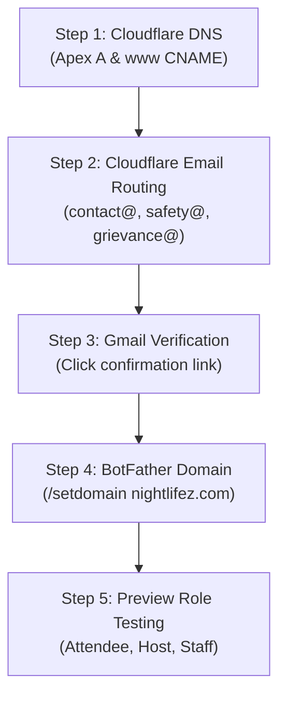

# NIGHTLIFEZ — Next Owner Actions & Infrastructure Runbook

**Target Domain:** [nightlifez.com](https://nightlifez.com)  
**Target Email:** `nightlifezofficial@gmail.com`  
**Telegram Bot:** `@Nightlifez_bot`  
**Timestamp:** 2026-11-13T12:46:16+05:30  
**Status:** **INFRASTRUCTURE AUDITED — REFINED OWNER RUNBOOK READY**

---

## 1. Inventory of Completed Actions

The following tasks have been completed and independently verified:

| Action ID | Category | Description | Status | Verification Reference |
|---|---|---|:---:|---|
| **ACT-01** | Vercel | Verified `nightlifez.com` attached to `strangersmeetup` as Primary Apex | **DONE — independently verified** | Vercel API: `verified: true` |
| **ACT-02** | Vercel | Verified `www.nightlifez.com` configured with HTTP 308 redirect to apex | **DONE — independently verified** | Vercel API: `redirectStatusCode: 308` |
| **ACT-03** | Security | Provisioned 11 Production env vars (`PUBLIC_SITE_URL`, `CRON_SECRET`, etc.) | **DONE — independently verified** | Vercel Project API response |
| **ACT-04** | Security | Eliminated ticket signing dev fallback in production (`lib/services/tickets.js`) | **DONE — independently verified** | Regression test in `test/production-readiness.test.js` |
| **ACT-05** | Security | Enforced cloud deployment guards on Preview Reviewer (`lib/dev-personas.js`) | **DONE — independently verified** | Regression test in `test/production-readiness.test.js` |
| **ACT-06** | Database | Confirmed Neon physical endpoints (`ep-dawn-glitter-b4mkwxkl` vs `ep-green-hall-b47clnq0`) | **DONE — independently verified** | Neon CLI & API queries |
| **ACT-07** | Database | Unarchived production compute timeline (`br-delicate-recipe-b4welnn6`) | **DONE — independently verified** | Neon API: branch state `ready` |
| **ACT-08** | Database | Resolved zero-table discrepancy: confirmed clean, unmigrated baseline | **DONE — independently verified** | Preflight query returned 0 tables |
| **ACT-09** | CI / E2E | PR #45 passed CI (157/157 lint, 700 unit/integration tests, Playwright E2E) | **DONE — independently verified** | GitHub Actions Check ID `131678066224` |
| **ACT-10** | Preview | Verified Preview deployment `dpl_DJytmh2LTMmZAzWGyeqyaGCNqGJC` routes (200 OK) | **DONE — independently verified** | `vercel curl` smoke suite |

---

## 2. What Remains Pending

| Pending Item | Required Party | Description | Status |
|---|---|---|:---:|
| **PEN-01** | Owner | Add A and CNAME records in Cloudflare DNS | **BLOCKED — owner action required** |
| **PEN-02** | Owner | Onboard Cloudflare Email Routing & verify destination in Gmail | **BLOCKED — owner action required** |
| **PEN-03** | Owner | Register domain `/setdomain nightlifez.com` in Telegram BotFather | **BLOCKED — owner action required** |
| **PEN-04** | Owner | Provide numeric channel ID & admin ID for Vercel env | **BLOCKED — owner action required** |
| **PEN-05** | Owner & Agent | Multi-role live browser testing of privileged roles in Preview | **BLOCKED — owner action required** |
| **PEN-06** | Agent | Merge PR #45 & PR #17 (Production Release) | **NOT DONE — intentionally withheld for safety** |
| **PEN-07** | Agent | Execute Production migrations | **NOT DONE — intentionally withheld for safety** |

---

## 3. Owner Actions Runbook (Step-by-Step)

### Step 1: Configure Cloudflare DNS Records
1. Open the [Cloudflare Dashboard](https://dash.cloudflare.com/) and select zone **`nightlifez.com`**.
2. Navigate to **DNS → Records**.
3. Add **Apex A Record**:
   - **Type:** `A`
   - **Name:** `@` (or `nightlifez.com`)
   - **IPv4 Address:** `76.76.21.21`
   - **Proxy Status:** **DNS only (Grey Cloud)** *(Crucial: do NOT turn on Orange Cloud)*
   - **TTL:** Auto
4. Add **WWW CNAME Record**:
   - **Type:** `CNAME`
   - **Name:** `www`
   - **Target:** `cname.vercel-dns.com`
   - **Proxy Status:** **DNS only (Grey Cloud)**
   - **TTL:** Auto

### Step 2: Onboard Cloudflare Email Routing
1. In Cloudflare, navigate to **Email Routing**.
2. Click **Get Started / Enable Email Routing**.
3. Accept the automatically generated MX records and SPF TXT record.
4. Under **Destination Addresses**, click **Add destination address** and enter:
   `nightlifezofficial@gmail.com`
5. Open your Gmail inbox (`nightlifezofficial@gmail.com`), locate the email from Cloudflare, and click the **Verify email address** link.
6. Under **Routing Rules**, create 3 Custom Addresses:
   - `contact@nightlifez.com` $\to$ `nightlifezofficial@gmail.com`
   - `safety@nightlifez.com` $\to$ `nightlifezofficial@gmail.com`
   - `grievance@nightlifez.com` $\to$ `nightlifezofficial@gmail.com`
7. Set Catch-All rule to **Drop** or **Disabled**.
8. Under **DNS Records**, add a TXT record for DMARC:
   - **Type:** `TXT`
   - **Name:** `_dmarc`
   - **Content:** `v=DMARC1; p=none; rua=mailto:nightlifezofficial@gmail.com`

### Step 3: Telegram BotFather Domain Registration
1. In Telegram, open [@BotFather](https://t.me/BotFather).
2. Send `/mybots` and select `@Nightlifez_bot`.
3. Select **Bot Settings → Domain**.
4. Enter: `nightlifez.com`.

### Step 4: Preview Role Acceptance Testing
1. Visit the protected preview:
   `https://strangersmeetup-git-launch-mvp-jakuraa.vercel.app`
2. Authenticate through Vercel SSO.
3. Test the attendee journey using the Reviewer mechanism.
4. For privileged roles (Host, Staff, Admin), log in via Telegram so the application can associate your real Telegram identity and assign appropriate roles.

---

## 4. Key Risks and Blockers

1. **Proxy Risk (Cloudflare Orange Cloud):**
   If records are saved with proxy enabled (Orange Cloud), Cloudflare intercepts SSL and traffic before Vercel. This breaks Vercel's automated Let's Encrypt certificate issuance and disables edge DDoS signals. **Records MUST be Grey Cloud (DNS only)**.
2. **Outbound Mail Expectation:**
   Cloudflare Email Routing is purely **inbound forwarding**. You cannot send email replies from Gmail with a genuine `From: contact@nightlifez.com` header without an outbound SMTP provider (e.g. Resend or Google Workspace) that cryptographically signs DKIM.
3. **Privileged Role Preview Blockers:**
   The built-in Preview Reviewer is intentionally hardcoded to attendee-only permissions to prevent security leaks. Privileged roles (Organiser, Staff, Admin) cannot be tested via the reviewer button; they require an authorised session.

---

## 5. The Single Safest Next Step

👉 **Add the Apex A record (`@` $\to$ `76.76.21.21`) and WWW CNAME record (`www` $\to$ `cname.vercel-dns.com`) in Cloudflare DNS as DNS-only (Grey Cloud).**

*Why this is the safest step:*
- It only points DNS to Vercel's edge.
- It does not touch the database.
- It does not deploy or merge any code.
- It does not enable live payments.
- It instantly turns Vercel's domain status to **Valid Configuration** and provisions the TLS certificate.
