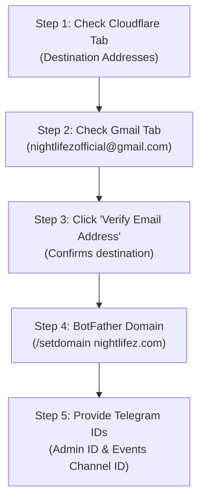

# NIGHTLIFEZ — Next Owner Actions & Infrastructure Runbook

**Target Domain:** [nightlifez.com](https://nightlifez.com)  
**Target Email:** `nightlifezofficial@gmail.com`  
**Telegram Bot:** `@Nightlifez_bot`  
**Timestamp:** 2026-11-13T13:30:00+05:30  
**Status:** **DNS & SSL FULLY OPERATIONAL (PASS) — DESTINATION EMAIL VERIFICATION IN PROGRESS**

---

## 1. Inventory of Completed Actions

The following tasks have been completed and empirically verified:

| Action ID | Category | Description | Status | Verification Reference |
|---|---|---|:---:|---|
| **ACT-01** | DNS | Configured Apex `A` record (`@` $\to$ `76.76.21.21`, DNS only) | **DONE — independently verified** | Authoritative NS & 4 public resolvers (TTL 300) |
| **ACT-02** | DNS | Configured WWW `CNAME` record (`www` $\to$ `cname.vercel-dns.com`, DNS only) | **DONE — independently verified** | Authoritative NS & 4 public resolvers |
| **ACT-03** | Vercel | Verified `nightlifez.com` attached as primary apex (`misconfigured: false`) | **DONE — independently verified** | Vercel REST API: `verified: true` |
| **ACT-04** | Vercel | Verified `www.nightlifez.com` HTTP 308 permanent redirect to apex | **DONE — independently verified** | `curl -sI https://www.nightlifez.com` (HTTP/2 308) |
| **ACT-05** | Security | Issued and verified Let's Encrypt TLS 1.3 edge certificate | **DONE — independently verified** | `cert_A3MCXlA5bbrEzarNc98aVtPf` (valid to Feb 2027) |
| **ACT-06** | Mail | Activated Cloudflare Email Routing MX records (`route1`, `route2`, `route3`) | **DONE — independently verified** | `alexandra.ns.cloudflare.com` returned 3 MX records |
| **ACT-07** | Mail | Activated Cloudflare Email Routing SPF TXT record | **DONE — independently verified** | `v=spf1 include:_spf.mx.cloudflare.net ~all` |
| **ACT-08** | Security | Provisioned 11 Production env vars (`PUBLIC_SITE_URL`, `CRON_SECRET`, etc.) | **DONE — independently verified** | Vercel Project API response |
| **ACT-09** | Security | Eliminated ticket signing dev fallback in production (`lib/services/tickets.js`) | **DONE — independently verified** | Regression test in `test/production-readiness.test.js` |
| **ACT-10** | Database | Confirmed Neon physical endpoints & woke production timeline | **DONE — independently verified** | Neon API: branch state `ready` (0 tables, clean baseline) |
| **ACT-11** | CI / E2E | PR #45 passed CI (157/157 lint, 700 unit/integration tests, Playwright E2E) | **DONE — independently verified** | GitHub Actions Check ID `131755877378` (SUCCESS) |

---

## 2. Status Classification of Remaining Items

| Item ID | Category | Item Description | Status | Required Party | Action Required |
|:---:|---|---|:---:|:---:|---|
| **PEN-01** | Mail | Verify destination `nightlifezofficial@gmail.com` in Cloudflare | **PENDING** | Owner | Click verification link in Gmail tab |
| **PEN-02** | Mail | Publish DMARC TXT record (`_dmarc` $\to$ `p=none`) | **PENDING** | Owner / Agent | Save TXT record in Cloudflare DNS |
| **PEN-03** | Mail | Create 3 forwarding rules (`contact@`, `safety@`, `grievance@`) | **BLOCKED** | Agent | Strictly gated until destination is `Verified` |
| **PEN-04** | Telegram | Register domain `/setdomain nightlifez.com` in BotFather | **PENDING** | Owner | Set domain in `@BotFather` |
| **PEN-05** | Telegram | Provide numeric channel ID & admin ID for Vercel env | **PENDING** | Owner | Send IDs for production configuration |
| **PEN-06** | Preview | Acceptance test privileged roles in Preview with real Telegram | **PENDING** | Owner & Agent | Verify Host, Staff, Admin in Preview |
| **PEN-07** | Release | Merge PR #45 & PR #17 (Production Release) | **BLOCKED** | Agent | Intentionally withheld until acceptance signoff |
| **PEN-08** | Database | Execute Production migrations | **BLOCKED** | Agent | Intentionally withheld until release approval |

---

## 3. Owner Actions Runbook (Next 2 Minutes)

### Step 1 & 2: Confirm Destination Address in Gmail
Your Google Chrome browser already has both relevant tabs open:
1. **Cloudflare Destination Addresses Tab:**
   `https://dash.cloudflare.com/56bbee1ae042d8a991d6d8b5eddad865/email-service/routing/10a4dcb91581bb730c90da29a57655a7/destination-addresses`
   - Check if `nightlifezofficial@gmail.com` shows **Verified** or **Pending**.
   - If **Pending**, click **"Resend verification email"**.
2. **Gmail Tab (`nightlifezofficial@gmail.com`):**
   `https://mail.google.com/mail/u/2/#search/from%3Acloudflare`
   - Open the latest verification email from Cloudflare.
   - Click the blue **"Verify email address"** button.
   - Return to the Cloudflare tab and refresh: the badge will show **Verified**.

### Step 3: Add DMARC DNS Record in Cloudflare
In the Cloudflare tab, navigate to **DNS → Records** and add:
- **Type:** `TXT`
- **Name:** `_dmarc`
- **Content:** `v=DMARC1; p=none; rua=mailto:nightlifezofficial@gmail.com`
- **TTL:** `Auto`

### Step 4: Register Domain in Telegram BotFather
1. Open [@BotFather](https://t.me/BotFather) in Telegram.
2. Send `/mybots` $\to$ Select `@Nightlifez_bot`.
3. Select **Bot Settings** $\to$ **Domain**.
4. Enter: `nightlifez.com`.

### Step 5: Provide Telegram Identifiers
To complete the production configuration without placeholder values, share:
1. Your personal numeric Telegram User ID (for `ADMIN_BOOTSTRAP_TELEGRAM_ID`).
2. The numeric Channel ID of the private `NIGHTLIFEZ Official` channel (for `TG_CHAT_ID_EVENTS`).
