# NIGHTLIFEZ Payment Provider Readiness Assessment: PhonePe PG & Fallback Rails

**Milestone:** M4.2 — Independent UPI Payment Security & Production Readiness Audit  
**Date:** November 2026  
**Auditor:** Independent Payments Architect  
**Safety Gate:** `ENABLE_LIVE_PAYMENTS=false` Enforced across all environments  
**Readiness Verdict:** **NOT READY FOR LIVE PRODUCTION** · **MOCK / SIMULATED READY ONLY**

---

## 1. Executive Summary

Milestone M4.1 positioned **PhonePe Payment Gateway** as the primary UPI checkout provider and **PayU** as the designated secondary/fallback provider.

This independent audit evaluated the concrete source code in `lib/upi/adapter.js`, `lib/services/upi-payments.js`, and `lib/handlers/upi-checkout.js` against official developer documentation, API specifications, and operational requirements.

### Key Audit Conclusions:
1. **PhonePe PG**: The integration is **partially implemented and predominantly mocked/offline**. The codebase does not initiate payment orders with PhonePe’s server-side API (`/pg/v1/pay`). Instead, it synthesizes a direct NPCI UPI URI offline. While status checking and refunds are coded, they cannot interact with PhonePe’s gateway without prior server-side order initiation. Furthermore, webhook signature verification uses an incorrect hashing formula that fails against authentic PhonePe payloads.
2. **PayU Fallback**: **NOT IMPLEMENTED IN CODE**. PayU was described in architectural documentation, but zero lines of executable PayU adapter code, hash generators, or webhook receivers exist in the repository. It is purely architecturally proposed.
3. **Mock Sandbox**: **IMPLEMENTED AND FULLY TESTED**. The `MockUpiAdapter` allows deterministic unit testing and local development, but does not provide real payment processing.

---

## 2. PhonePe Payment Gateway Capability Breakdown

| Capability / Flow | Implementation Status | Test Status | Classification | Audit Notes & Findings |
| :--- | :--- | :--- | :--- | :--- |
| **Payment Intent Creation (`/pg/v1/pay`)** | **Not Implemented** | **Simulated / Offline** | **Not Implemented** | Does not call PhonePe's `/pg/v1/pay` or `/checkout/v2/pay`. Generates a direct peer/merchant UPI URI (`upi://pay?pa=nightlifez@ybl...`) locally. PhonePe's servers have no record of the order. |
| **Dynamic QR Generation** | **Implemented** | **Tested** | **Implemented (Local Engine)** | Pure ECMAScript QR generator (`lib/upi/qr.js`) converts local NPCI UPI string to vector SVG. Does not use PhonePe's gateway-hosted dynamic QR. |
| **Mobile UPI App Intents** | **Implemented** | **Tested** | **Implemented (Local Engine)** | Deep links constructed locally for generic `upi://`, Google Pay (`gpay://`), PhonePe (`phonepe://`), Paytm (`paytmmp://`), CRED (`credpay://`), BHIM (`bhim://`). |
| **Order & Merchant Identifiers** | **Implemented** | **Tested** | **Requires Merchant Onboarding** | Uses default UAT test merchant `PGTESTPAYUAT`. Prefix format `ORD-UPI-{timestamp}-{hex}` complies with PhonePe 35-character limit. |
| **Request Checksum (`signRequest`)** | **Implemented** | **Unit Tested** | **Implemented** | Implements `SHA256(body + endpoint + saltKey) + "###" + saltIndex` correctly for outbound GET/POST requests. |
| **Server-to-Server Webhook Verification** | **Defective Implementation** | **Flawed Mock Test** | **Requires Remediation** | **CRITICAL DEFECT (SEC-01)**: Hashed entire raw HTTP JSON body instead of the unescaped Base64 `response` string. Rejects 100% of authentic PhonePe callbacks. |
| **Authoritative Status Query (`/pg/v1/status`)** | **Implemented** | **Mocked in Tests** | **Requires Merchant Onboarding** | Endpoints `/pg/v1/status/{merchantId}/{orderId}` implemented correctly, but will return `TRANSACTION_NOT_FOUND` unless `/pg/v1/pay` is called first. |
| **Automated Refunds (`/pg/v1/refund`)** | **Implemented** | **Mocked in Tests** | **Implemented but Untested on Real PG** | Implements `/pg/v1/refund` with Base64 payload, `X-VERIFY`, and auto-revocation of Telegram access. Unit tested via HTTP stub. |
| **Timeout & Outage Handling** | **Partially Implemented** | **Unit Tested** | **Partially Implemented** | Catch blocks wrap network errors into `PaymentAdapterError` with status 502. However, automated retry queues and circuit breakers are absent. |
| **Preview vs Production Credential Isolation** | **Configured** | **Verified** | **Requires Merchant Onboarding** | Reads from `PHONEPE_MERCHANT_ID`, `PHONEPE_SALT_KEY`, `PHONEPE_HOST_URL`. All environments currently default to PhonePe Sandbox UAT keys. |

---

## 3. PayU Fallback Audit

User Requirement:
> "Determine whether PayU is:
> - Fully implemented.
> - Partially implemented.
> - Only architecturally prepared.
> - Not implemented.
> Do not describe a provider as fallback-ready merely because the adapter interface supports it."

### Findings:
- **Search Query**: A search across the entire `lib/` directory for "PayU", "payu", or PayU hash algorithms (`sha512(key|txnid|amount|productinfo|firstname|email|udf1...|salt)`) yielded **0 results**.
- **Code State**: No PayU adapter class exists. No PayU webhook route (`/api/payments/webhook/payu`) exists. No PayU configuration variables exist in `.env.example` or `config.js`.
- **Verdict**: **ONLY ARCHITECTURALLY PREPARED / NOT IMPLEMENTED IN CODE**.
- While the `PaymentAdapter` interface (`createPaymentIntent`, `getPaymentStatus`, `verifyWebhook`, `initiateRefund`) was designed to accommodate PayU, zero executable PayU code has been written.

---

## 4. Architectural Disconnect: Online PG vs Direct UPI URI

The most critical architectural discovery of this audit is the **fundamental divergence between PhonePe Payment Gateway and the implemented UPI checkout mechanism**:

```mermaid
flowchart TD
    subgraph Current Implementation ["Current Implementation (Offline NPCI UPI)"]
        A1[User clicks Checkout] --> B1[Server generates ORD-UPI-XXX]
        B1 --> C1[Local buildUpiUri: nightlifez@ybl]
        C1 --> D1[User scans QR or taps GPay/PhonePe]
        D1 --> E1[Money sent directly to VPA nightlifez@ybl]
        E1 -.->|DISCONNECT| F1[PhonePe PG has NO RECORD of this transaction]
        F1 -.->|PhonePe Webhook NEVER FIRES| G1[Booking cannot confirm automatically]
    end

    subgraph Standard PhonePe PG Flow ["Standard PhonePe PG Flow (Required for Gateway Automation)"]
        A2[User clicks Checkout] --> B2[Server calls POST /pg/v1/pay]
        B2 --> C2[PhonePe returns Gateway Intent URL & Dynamic QR]
        C2 --> D2[User pays via PhonePe hosted rail]
        D2 --> E2[PhonePe captures funds in Merchant Nodal Account]
        E2 --> F2[PhonePe S2S Webhook POST /api/payments/webhook/phonepe]
        F2 --> G2[Server cryptographically confirms booking]
    end
```



### Consequences:
1. In the current implementation, scanning the QR code sends funds directly to the VPA `nightlifez@ybl` across standard bank-to-bank UPI.
2. Because PhonePe's `/pg/v1/pay` was never called, PhonePe's servers have no transaction order registered.
3. PhonePe will **never** trigger the webhook at `/api/payments/webhook/phonepe`.
4. Calling PhonePe's status API will fail with `TRANSACTION_NOT_FOUND`.
5. Therefore, the dynamic QR and mobile intent checkout currently functions as a **manual VPA transfer with zero automated server confirmation**.

---

## 5. Payment Readiness Decision

### Final Verdict: **ENGINEERING REMEDIATION COMPLETE (M4.3)** · **AWAITING OWNER PRODUCTION GATE & BUSINESS ONBOARDING**
### Current State: **MOCK / SIMULATED READY & AUDITED SANDBOX PASSING**

### Readiness Status:

#### A. Code & Architectural Prerequisites (Engineering — Completed in M4.3, M4.3.1, M4.3.2 & M4.3.3)
- [x] **Fix Webhook Signature Calculation**: Updated `verifyWebhookSignature` in `lib/upi/adapter.js` to compute `SHA256(response + saltKey) + "###" + saltIndex` on the decoded payload object. Verified with PhonePe S2S test.
- [x] **Strict Webhook Amount Verification (REV-04)**: Implemented in `applySuccessfulUpiPayment` and `processUpiWebhook`; requires safe positive integer exact paise match; currency and merchantId match; underpayment or malformed amounts are marked `disputed` with 0 bookings created.
- [x] **Fail-Closed Merchant Identity & Currency Invariance (M4.3.2 & M4.3.3)**: Replaced permissive merchant logic with strict fail-closed verification across verified, stored, and server-configured merchant IDs. Rejects missing, null, empty string, or mismatched merchant IDs across PhonePe PG and mock adapters. Enforces non-empty `'INR'` currency matching.
- [x] **Elimination of Currency Defaults & Synthetic Fallbacks (M4.3.3)**: Removed `verified.currency || 'INR'` in webhook processing and `gatewayStatus.currency || 'INR'` in polling. Missing currency remains missing (`null`) across all adapters. Never manufactures INR as proof of provider verification.
- [x] **Elimination of Configured Merchant Fallback in Status Check (M4.3.3)**: Removed `data.merchantId || this.merchantId` fallback in `PhonePeAdapter.getPaymentStatus`. Provider status responses missing `merchantId` remain `null`, preventing synthetic identity substitution. Three-way comparison in `applySuccessfulUpiPayment` fails closed with `missing_verified_merchant_id` or `merchant_mismatch`.
- [x] **Provider API Limitations Disclosed (M4.3.3)**: Documented that PhonePe domestic PG typically omits an explicit `currency` field in standard v1 responses; automated confirmation strictly requires explicit provider currency and merchant identity.
- [x] **Secure Manual Refund Reconciliation & Operator Attestation (M4.3.2 & M4.3.3)**: Prohibited generated or placeholder `MANUAL-...` references. Implemented `verifyFinanceAuthorization` checking active database roles (`super_admin`, `finance`), `isValidExternalRefundRef` requiring verifiable external references (bank UTR, PG refund ARN), and `isValidEvidenceRef` requiring documented evidence references recorded in the immutable audit ledger. Documented operational CBS limitation and labeled attestation as `operator_attested: true`, `bankVerified: false`.
- [x] **Enforce Authentication on `/checkout/:slug/upi`**: Gated unauthenticated users with redirect to `/signin`; guest checkout assigns guestToken and requires authenticated claim via `/api/checkout/upi/claim`.
- [x] **Duplicate Booking Protection (REV-02)**: Prevented duplicate active bookings during intent creation (409 `already_booked`), confirmation locked transaction (queued for refund in `refund_pending`), guest claims (409), and database constraint races (SQLSTATE `23505` savepoint recovery).
- [x] **Refund Operational Recovery & Reconciliation (REV-03, M4.3.2)**: Permitted refunding payments in both `succeeded` and `refund_pending` states; isolated external gateway calls outside holding transactions; caught provider failures without losing audit state; added authorized manual finance reconciliation mechanism; ensured booking revocation and chat removals fire only upon confirmed refund.
- [x] **Active Intent Inventory Reservation & Tier Index (REV-07)**: Added `activePaymentHolds` and `activeTierPaymentHolds` to hold seats during unexpired intents; added migration 017 index `idx_payments_active_tier_holds`; re-checks capacity at confirmation time.
- [x] **ISO/IEC 18004 Standard QR Compliance (REV-01, REV-05)**: Full support for QR Versions 1 through 14 (up to 362 bytes) with BCH(18, 6) Golay Version Information blocks, corrected alignment pattern placement, Dark Module preservation, user-facing 400 validation for overlong payloads, and 100% independent `jsQR` decoder validation.
- [x] **CSS Viewport Isolation**: Added media queries in `renderUpiCheckout` toggling display between `.checkout-mobile` and `.checkout-desktop`.
- [x] **Audit Ledger Immutability**: Added migration 016 with database trigger blocking UPDATE and DELETE on `payment_audits`.

#### B. Commercial & Regulatory Prerequisites (Business & Operations — Owner Gate)
- [ ] **PhonePe KYB Onboarding**: Complete business KYC, bank account verification, and merchant contract execution.
- [ ] **Production API Credentials**: Acquire Production Merchant ID, Salt Key, and Salt Index from the PhonePe Merchant Portal.
- [ ] **VPA Whitelisting**: Ensure the merchant VPA is officially linked to the PhonePe merchant nodal account.
- [ ] **S2S Webhook URL Configuration**: Register `https://strangersmeetup.com/api/payments/webhook/phonepe` in PhonePe dashboard.
- [ ] **End-to-End ₹1 Pilot Transaction**: Execute and verify a live ₹1 payment and subsequent refund in a staging/preview environment before releasing to customers.

---

## 6. Safety Gate Enforcement

The safety switch remains locked:
```bash
ENABLE_LIVE_PAYMENTS=false
```
Under no circumstances should this flag be set to `true` until all engineering defects in Section 5A are resolved, verified by automated tests, and formal business signoff in Section 5B is granted.

---

## 7. M4.3.4 Final Payment Provider Contract Determination & Safe Integration Decision

### 7.1 Detailed Technical Analysis of PhonePe API v1 Contract

An exhaustive inspection of PhonePe's official API specifications and the concrete adapter implementation (`lib/upi/adapter.js`, `lib/services/upi-payments.js`) established the following technical boundaries:

#### 1. Authenticated Status Request URL vs Missing JSON `merchantId`
- **Outbound Check Status Request**:
  - Endpoint: `GET /apis/pg-sandbox/pg/v1/status/{merchantId}/{merchantTransactionId}`
  - Transport Security: Server-to-server HTTPS (TLS 1.2/1.3) directly to PhonePe.
  - Caller Authentication: `X-MERCHANT-ID: {merchantId}` and `X-VERIFY: SHA256('/pg/v1/status/' + merchantId + '/' + orderId + saltKey) + '###' + saltIndex`.
  - PhonePe authenticates the caller using the shared `saltKey` and verifies that the transaction belongs to the path-specified `{merchantId}`. Unmatched requests are rejected with HTTP 401/403 `AUTHORIZATION_FAILED`.
- **Response Merchant Identity Determination**:
  - In PhonePe's standard v1 response JSON, `data.merchantId` is documented to echo the merchant identifier.
  - However, the HTTP GET response body is **plain unsigned JSON**. PhonePe provides no cryptographic response signature or response HMAC header (unlike webhooks, which include `X-VERIFY`).
  - If a gateway status response omits `data.merchantId` or returns null/empty, relying on the URL path alone would require the client adapter to "assume" or "synthesize" merchant identity.
  - Under the strict zero-trust financial integrity policy established in M4.3.2 and M4.3.3, identity synthesis is prohibited. If `merchantId` is absent from the provider payload, it remains `null` and fails closed (`missing_verified_merchant_id`), preventing rogue or cross-merchant substitution.

#### 2. Documented Domestic UPI Contract vs Missing Currency Field
- **The Statutory Contract**:
  - PhonePe PG v1/v2 operates under the regulatory jurisdiction of the Reserve Bank of India (RBI) and National Payments Corporation of India (NPCI) exclusively for domestic UPI and Indian banking instruments.
  - The business and regulatory contract is strictly denominated in Indian Rupees (INR) with amounts expressed in integer paise (1 INR = 100 paise).
  - Multi-currency processing does not exist on PhonePe's domestic UPI Standard Checkout.
- **The Technical Contract**:
  - PhonePe's official API schema (status check response and S2S callback payloads) **never includes a `currency` field**.
  - `data.currency` is strictly `undefined` in authentic PhonePe payloads.
- **Zero-Trust Invariant Conflict**:
  - The core verification engine (`applySuccessfulUpiPayment`) strictly requires affirmative evidence that `currency === 'INR'` and matches `payment.currency`.
  - When the adapter faithfully extracts `data.currency`, it evaluates to `null`.
  - Without synthetic defaults, every native PhonePe transaction is disputed with `Payment verification failed: Currency mismatch (missing_currency)`.
  - Injecting a hardcoded default (`currency: 'INR'`) inside the adapter would manufacture evidence that the provider did not supply, violating the project's zero-trust audit guarantees.

#### 3. Cryptographic Authentication: Signed vs Unsigned Fields
- **S2S Webhook (`POST /api/payments/webhook/phonepe`)**:
  - Header: `X-VERIFY: SHA256(base64Response + saltKey) + "###" + saltIndex`.
  - Body: `{ "response": "<base64_string>" }`.
  - Because `X-VERIFY` is calculated over the entire base64 string, every field inside the decoded `data` object (`merchantId`, `merchantTransactionId`, `transactionId`, `amount`, `state`, `paymentInstrument`) is cryptographically signed and authenticated by PhonePe using the shared merchant secret.
  - However, `currency` is completely absent from this signed payload.
- **Status Polling API (`GET /pg/v1/status/...`)**:
  - The outbound request is authenticated by the merchant; the inbound response is **NOT signed** by PhonePe. Authenticity relies entirely on TLS transport security to the PhonePe host.

#### 4. Distinguishing Authentic from Fabricated or Mismatched Responses
- The current implementation reliably distinguishes authentic from forged responses:
  - Webhooks with invalid, tampered, or missing `X-VERIFY` signatures are immediately rejected with `WebhookSignatureError` (HTTP 401).
  - Webhooks with mismatched or missing `merchantId` are rejected before database writes.
  - Status queries with mismatched `merchantId`, underpayment/overpayment, or missing currency fail closed and transition the payment to `disputed` with 0 bookings and 0 Telegram invites created.
  - Database-level immutable audit logging records every verification failure in `payment_audits`.

---

### 7.2 Decision: Safe Integration Approach

Three potential outcomes were evaluated:

- **Outcome A (Rejected)**: *PhonePe safely supported with adapter-level domestic contract assumptions.*
  - Would require mapping PhonePe's domestic banking contract to synthetic `currency: 'INR'` at the adapter boundary.
  - **Why Rejected**: Directly contradicts M4.3.3 integrity findings, manufactures provider evidence not present in JSON payloads, weakens the zero-trust verification standard, and violates Non-Negotiable Safeguard #5.

- **Outcome B (ADOPTED)**: *PhonePe cannot currently meet the required verification standard. Keep it sandbox-only and recommend a provider whose documented API supplies the required merchant, amount, order and currency evidence.*
  - **Verdict**: **FORMALLY ADOPTED**.
  - **Rationale**:
    1. PhonePe v1 API cannot supply machine-verifiable currency evidence without client-side assumptions.
    2. PhonePe status GET responses are not cryptographically signed by the provider.
    3. Under the fail-closed zero-trust financial integrity architecture, PhonePe payments must remain sandbox/mock only.
    4. Production live-payment capability for PhonePe is marked **BLOCKED**.
    5. Milestone M4 can safely close with `ENABLE_LIVE_PAYMENTS=false` preserved across all environments, with zero real financial exposure.

- **Outcome C (Rejected)**: *Wait for additional provider integration or contract confirmation before architecture approval.*
  - **Why Rejected**: Postpones closure indefinitely without technical merit. The platform's booking integrity, seat allocation, refund controls, and audit ledger are fully built, audited, and tested.

---

### 7.3 Comparative Provider Evaluation: Zero-Trust Readiness

| Capability / Evidence | PhonePe PG v1 | Standard Zero-Trust Gateway Spec | Audit Requirement |
| :--- | :--- | :--- | :--- |
| **S2S Webhook Signature** | HMAC SHA256 on base64 | HMAC SHA256 on raw body (`x-signature`) | Cryptographically authenticates sender |
| **Provider-Signed Status Response** | ❌ None (TLS only) | ✅ Direct Auth Key+Secret over TLS | Proves provider authenticity |
| **Explicit ISO Currency Field** | ❌ **Omitted** (Implicit INR) | ✅ **Included** (`"INR"` in payload `currency`) | Zero-trust currency invariant verification |
| **Paise Amount Exact Match** | ✅ Integer paise | ✅ Integer paise (`amount`) | Exact financial match |
| **Merchant ID in Callback** | ✅ `data.merchantId` | ✅ Account / `account_id` | Three-way identity comparison |
| **Zero-Trust Live Gate Verdict** | **BLOCKED (Sandbox Only)** | **RECOMMENDED FOR M5** | Meets zero-trust verification |

---

### 7.4 Prerequisites for Production Payment Activation (Owner / Provider Action)

To transition payment processing from `ENABLE_LIVE_PAYMENTS=false` to live production, the following prerequisites must be fulfilled:

1. **Provider Selection & Migration (M5)**:
   - Either migrate to a zero-trust provider with explicit ISO currency support and signed callbacks, OR
   - Upgrade to PhonePe's newer PG v2 SDK if/when PhonePe provides official, machine-verifiable currency fields and signed status query endpoints.
2. **KYB & Commercial Contracting**: Complete merchant onboarding, bank nodal account binding, and production credential issuance.
3. **Webhook Whitelisting**: Register production webhook endpoints with HTTPS TLS termination.
4. **₹1 Financial Pilot**: Execute an end-to-end live ₹1 payment and subsequent refund under supervision on a dedicated staging branch before enabling production traffic.

---

## 8. Note for any future PhonePe onboarding: the currency rule (2026-11-10, no code change)

**Status:** UPI checkout stays off (`UPI_CHECKOUT_ENABLED=false`). This section changes no behaviour. It records a design consequence so it is not rediscovered later.

- The verification engine requires the **provider payload** to state `currency === 'INR'` (§7.1.2). PhonePe's domestic v1 status and callback payloads never carry a `currency` field. So, **by design, no genuine PhonePe v1 payment can ever auto-confirm**: every one ends up `disputed` with `missing_currency`. This is not a bug in the adapter. It is the rule working exactly as written against a provider that cannot meet it.
- The rule was written to stop the adapter from *manufacturing* evidence (`currency || 'INR'`). That goal is right. But "the provider must echo the currency" is only one way to establish the INR invariant. For a domestic-only UPI merchant account, INR is fixed by the **signed merchant agreement and the merchant configuration**, not by each payload.
- **If PhonePe ever onboards the merchant**, revisit the rule before enabling anything. Derive the invariant from (a) the server-configured merchant ID matching the signed status response's merchant scope, (b) the merchant contract and configuration declaring domestic INR only, and (c) the exact-paise amount match. Write that derivation down explicitly in config, e.g. as a per-provider `currencyEvidence: 'contract'` rather than `'payload'`. Do not reintroduce a silent default. The change needs its own review, tests showing a missing payload currency is accepted **only** for a contract-INR provider, and an owner sign-off.
- Until then, Outcome B (§7.2) stands.
