# NIGHTLIFEZ Payment Provider Readiness Assessment: PhonePe PG & Fallback Rails

**Milestone:** M4.2 — Independent UPI Payment Security & Production Readiness Audit  
**Date:** November 2026  
**Auditor:** Independent Payments Architect  
**Safety Gate:** `ENABLE_LIVE_PAYMENTS=false` Enforced across all environments  
**Readiness Verdict:** **NOT READY FOR LIVE PRODUCTION** · **MOCK / SIMULATED READY ONLY**

---

## 1. Executive Summary

Milestone M4.1 positioned **PhonePe Payment Gateway** as the primary UPI checkout provider and **PayU** as the designated secondary/fallback provider.

This independent audit evaluated the concrete source code in `lib/upi/adapter.js`, `lib/services/upi-payments.js`, and `lib/handlers/upi-checkout.js` against official developer documentation, API specifications, and operational requirements.

### Key Audit Conclusions:
1. **PhonePe PG**: The integration is **partially implemented and predominantly mocked/offline**. The codebase does not initiate payment orders with PhonePe’s server-side API (`/pg/v1/pay`). Instead, it synthesizes a direct NPCI UPI URI offline. While status checking and refunds are coded, they cannot interact with PhonePe’s gateway without prior server-side order initiation. Furthermore, webhook signature verification uses an incorrect hashing formula that fails against authentic PhonePe payloads.
2. **PayU Fallback**: **NOT IMPLEMENTED IN CODE**. PayU was described in architectural documentation, but zero lines of executable PayU adapter code, hash generators, or webhook receivers exist in the repository. It is purely architecturally proposed.
3. **Mock Sandbox**: **IMPLEMENTED AND FULLY TESTED**. The `MockUpiAdapter` allows deterministic unit testing and local development, but does not provide real payment processing.

---

## 2. PhonePe Payment Gateway Capability Breakdown

| Capability / Flow | Implementation Status | Test Status | Classification | Audit Notes & Findings |
| :--- | :--- | :--- | :--- | :--- |
| **Payment Intent Creation (`/pg/v1/pay`)** | **Not Implemented** | **Simulated / Offline** | **Not Implemented** | Does not call PhonePe's `/pg/v1/pay` or `/checkout/v2/pay`. Generates a direct peer/merchant UPI URI (`upi://pay?pa=nightlifez@ybl...`) locally. PhonePe's servers have no record of the order. |
| **Dynamic QR Generation** | **Implemented** | **Tested** | **Implemented (Local Engine)** | Pure ECMAScript QR generator (`lib/upi/qr.js`) converts local NPCI UPI string to vector SVG. Does not use PhonePe's gateway-hosted dynamic QR. |
| **Mobile UPI App Intents** | **Implemented** | **Tested** | **Implemented (Local Engine)** | Deep links constructed locally for generic `upi://`, Google Pay (`gpay://`), PhonePe (`phonepe://`), Paytm (`paytmmp://`), CRED (`credpay://`), BHIM (`bhim://`). |
| **Order & Merchant Identifiers** | **Implemented** | **Tested** | **Requires Merchant Onboarding** | Uses default UAT test merchant `PGTESTPAYUAT`. Prefix format `ORD-UPI-{timestamp}-{hex}` complies with PhonePe 35-character limit. |
| **Request Checksum (`signRequest`)** | **Implemented** | **Unit Tested** | **Implemented** | Implements `SHA256(body + endpoint + saltKey) + "###" + saltIndex` correctly for outbound GET/POST requests. |
| **Server-to-Server Webhook Verification** | **Defective Implementation** | **Flawed Mock Test** | **Requires Remediation** | **CRITICAL DEFECT (SEC-01)**: Hashed entire raw HTTP JSON body instead of the unescaped Base64 `response` string. Rejects 100% of authentic PhonePe callbacks. |
| **Authoritative Status Query (`/pg/v1/status`)** | **Implemented** | **Mocked in Tests** | **Requires Merchant Onboarding** | Endpoints `/pg/v1/status/{merchantId}/{orderId}` implemented correctly, but will return `TRANSACTION_NOT_FOUND` unless `/pg/v1/pay` is called first. |
| **Automated Refunds (`/pg/v1/refund`)** | **Implemented** | **Mocked in Tests** | **Implemented but Untested on Real PG** | Implements `/pg/v1/refund` with Base64 payload, `X-VERIFY`, and auto-revocation of Telegram access. Unit tested via HTTP stub. |
| **Timeout & Outage Handling** | **Partially Implemented** | **Unit Tested** | **Partially Implemented** | Catch blocks wrap network errors into `PaymentAdapterError` with status 502. However, automated retry queues and circuit breakers are absent. |
| **Preview vs Production Credential Isolation** | **Configured** | **Verified** | **Requires Merchant Onboarding** | Reads from `PHONEPE_MERCHANT_ID`, `PHONEPE_SALT_KEY`, `PHONEPE_HOST_URL`. All environments currently default to PhonePe Sandbox UAT keys. |

---

## 3. PayU Fallback Audit

User Requirement:
> "Determine whether PayU is:
> - Fully implemented.
> - Partially implemented.
> - Only architecturally prepared.
> - Not implemented.
> Do not describe a provider as fallback-ready merely because the adapter interface supports it."

### Findings:
- **Search Query**: A search across the entire `lib/` directory for "PayU", "payu", or PayU hash algorithms (`sha512(key|txnid|amount|productinfo|firstname|email|udf1...|salt)`) yielded **0 results**.
- **Code State**: No PayU adapter class exists. No PayU webhook route (`/api/payments/webhook/payu`) exists. No PayU configuration variables exist in `.env.example` or `config.js`.
- **Verdict**: **ONLY ARCHITECTURALLY PREPARED / NOT IMPLEMENTED IN CODE**.
- While the `PaymentAdapter` interface (`createPaymentIntent`, `getPaymentStatus`, `verifyWebhook`, `initiateRefund`) was designed to accommodate PayU, zero executable PayU code has been written.

---

## 4. Architectural Disconnect: Online PG vs Direct UPI URI

The most critical architectural discovery of this audit is the **fundamental divergence between PhonePe Payment Gateway and the implemented UPI checkout mechanism**:

```mermaid
flowchart TD
    subgraph Current Implementation ["Current Implementation (Offline NPCI UPI)"]
        A1[User clicks Checkout] --> B1[Server generates ORD-UPI-XXX]
        B1 --> C1[Local buildUpiUri: nightlifez@ybl]
        C1 --> D1[User scans QR or taps GPay/PhonePe]
        D1 --> E1[Money sent directly to VPA nightlifez@ybl]
        E1 -.->|DISCONNECT| F1[PhonePe PG has NO RECORD of this transaction]
        F1 -.->|PhonePe Webhook NEVER FIRES| G1[Booking cannot confirm automatically]
    end

    subgraph Standard PhonePe PG Flow ["Standard PhonePe PG Flow (Required for Gateway Automation)"]
        A2[User clicks Checkout] --> B2[Server calls POST /pg/v1/pay]
        B2 --> C2[PhonePe returns Gateway Intent URL & Dynamic QR]
        C2 --> D2[User pays via PhonePe hosted rail]
        D2 --> E2[PhonePe captures funds in Merchant Nodal Account]
        E2 --> F2[PhonePe S2S Webhook POST /api/payments/webhook/phonepe]
        F2 --> G2[Server cryptographically confirms booking]
    end
```



### Consequences:
1. In the current implementation, scanning the QR code sends funds directly to the VPA `nightlifez@ybl` across standard bank-to-bank UPI.
2. Because PhonePe's `/pg/v1/pay` was never called, PhonePe's servers have no transaction order registered.
3. PhonePe will **never** trigger the webhook at `/api/payments/webhook/phonepe`.
4. Calling PhonePe's status API will fail with `TRANSACTION_NOT_FOUND`.
5. Therefore, the dynamic QR and mobile intent checkout currently functions as a **manual VPA transfer with zero automated server confirmation**.

---

## 5. Payment Readiness Decision

### Final Verdict: **NOT READY FOR PRODUCTION**
### Current State: **MOCK / SIMULATED READY ONLY**

### Missing Prerequisites Before Production Activation:

#### A. Code & Architectural Prerequisites (Engineering)
- [ ] **Fix Webhook Signature Calculation**: Update `verifyWebhookSignature` in `lib/upi/adapter.js` to compute `SHA256(response + saltKey) + "###" + saltIndex` on the decoded payload object.
- [ ] **Call PhonePe Gateway Initiation API**: Update `createPaymentIntent` to execute `POST /pg/v1/pay` (or PhonePe's QR API) so PhonePe's banking servers register the order before presenting the QR/intent to the customer.
- [ ] **Strict Webhook Amount Verification**: Validate `verified.amountPaise === payment.amount` before marking any payment `succeeded` or creating a booking pass.
- [ ] **Enforce Authentication on `/checkout/:slug/upi`**: Prevent unauthenticated guests from generating payment intents that crash with `NOT NULL bookings.user_id` on confirmation.
- [ ] **Active Intent Inventory Reservation**: Include pending unexpired payments in `seatsTaken` to prevent event overbooking under high traffic.
- [ ] **Fix QR Generator Bit Placement**: Correct `lib/upi/qr.js` to prevent Dark Module overwriting and handle multi-block capacities in Version 8.
- [ ] **CSS Viewport Isolation**: Toggle display between `.checkout-mobile` and `.checkout-desktop` via responsive media queries.

#### B. Commercial & Regulatory Prerequisites (Business & Operations)
- [ ] **PhonePe KYB Onboarding**: Complete business KYC, bank account verification, and merchant contract execution.
- [ ] **Production API Credentials**: Acquire Production Merchant ID, Salt Key, and Salt Index from the PhonePe Merchant Portal.
- [ ] **VPA Whitelisting**: Ensure the merchant VPA is officially linked to the PhonePe merchant nodal account.
- [ ] **S2S Webhook URL Configuration**: Register `https://strangersmeetup.com/api/payments/webhook/phonepe` in PhonePe dashboard.
- [ ] **End-to-End ₹1 Pilot Transaction**: Execute and verify a live ₹1 payment and subsequent refund in a staging/preview environment before releasing to customers.

---

## 6. Safety Gate Enforcement

The safety switch remains locked:
```bash
ENABLE_LIVE_PAYMENTS=false
```
Under no circumstances should this flag be set to `true` until all engineering defects in Section 5A are resolved, verified by automated tests, and formal business signoff in Section 5B is granted.
