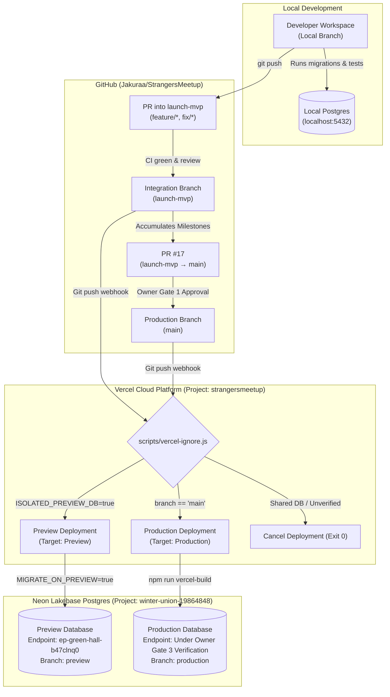

# NIGHTLIFEZ — Deployment Architecture

**Single source of truth for application deployment, environment boundaries, promotion pipeline, and recovery procedures.**

---

## 1. Executive Summary & Architecture Overview

NIGHTLIFEZ is hosted on **Vercel** (Serverless Node.js runtime in AWS `iad1` / Washington, D.C.) with database persistence powered by **Neon Lakebase Postgres** (AWS `us-east-2` / Ohio).

The deployment pipeline enforces a strict dual-track environment model:
1. **Preview Environment:** Automatically deployed from the integration branch `launch-mvp` and active PR branches. Preview deployments are physically isolated, bound to a dedicated Preview Neon database branch, and protected from public access by Vercel SSO / Deployment Protection.
2. **Production Environment:** Deployed exclusively from `main` via owner-approved Pull Requests (PR #17). Production builds are gated by explicit owner authorization, run with production environment variables, and map to the production compute endpoint.



---

## 2. Environment Segregation Matrix

| Attribute | Local / CI | Preview Environment | Production Environment |
|---|---|---|---|
| **Git Source** | Local working tree | `origin/launch-mvp` & PR branches | `origin/main` (PR #17) |
| **Vercel Target** | None (Local Node process) | `preview` | `production` |
| **Primary Domain** | `http://localhost:3000` | `strangersmeetup-git-launch-mvp-jakuraa.vercel.app` | `https://strangersmeetup-virid.vercel.app` (upcoming: `nightlifez.com`) |
| **Deployment Protection** | Disabled | **Active** (`ssoProtection: all_except_custom_domains`) | Public / Custom Domains |
| **Database Compute** | Ephemeral / Local Postgres | `ep-green-hall-b47clnq0` (`c-6.us-east-2.aws.neon.tech`) | Confirmed via Owner Gate 3 (suspected: `ep-dawn-glitter-b4mkwxkl`) |
| **Database Isolation** | Local socket/loopback only | Physically segregated branch (`preview`) | Physically segregated branch (`production`) |
| **Migrations Applied** | 003–014 (Auto on startup) | 003–014 (Gated: `MIGRATE_ON_PREVIEW=true`) | 003–009 (Pending PR #17 release) |
| **Live Payments** | `ENABLE_LIVE_PAYMENTS=false` | `ENABLE_LIVE_PAYMENTS=false` | `ENABLE_LIVE_PAYMENTS=false` (Free-only MVP) |
| **Telegram Bot** | Stubbed / dev persona | Test Bot / Disabled (`ALLOW_PREVIEW_TELEGRAM`) | Canonical Bot Token (`TELEGRAM_BOT_TOKEN`) |
| **Dev Persona Sign-in** | Available (`DEV_LOGIN=true`) | **404 Disabled** (Blocked by code rails) | **404 Disabled** (Blocked by code rails) |
| **Preview Reviewer Gate** | Disabled | **Available** (Synthetic guest role only) | **404 Disabled** (Blocked by code rails) |

---

## 3. Build & Deployment Triggers

### 3.1. Ignored Build Step (`scripts/vercel-ignore.js`)
To guarantee database isolation and avoid burning serverless build minutes, Vercel executes `node scripts/vercel-ignore.js` as the project's **Ignored Build Step**:
- **Exit Code 0:** Cancels / skips the deployment. Used when a branch build attempts to connect to an unisolated database or lacks the `ISOLATED_PREVIEW_DB=true` flag.
- **Exit Code 1:** Instructs Vercel to proceed with the build. Used for `main`, `launch-mvp`, or preview branches with confirmed database isolation.

```javascript
// scripts/vercel-ignore.js logic
const env = process.env.VERCEL_ENV || '';
const branch = process.env.VERCEL_GIT_COMMIT_REF || '';
const isProduction = env === 'production' || branch === 'main';
const isLaunchMvp = branch === 'launch-mvp';
const isIsolatedPreview = process.env.ISOLATED_PREVIEW_DB === 'true' || Boolean(process.env.PREVIEW_DATABASE_URL);

if (isProduction) {
  console.log(`[vercel-ignore] Production deployment on '${branch || env}' — proceeding with build.`);
  process.exit(1);
}
if (isLaunchMvp) {
  console.log(`[vercel-ignore] Integration Preview deployment on '${branch}' — proceeding with build.`);
  process.exit(1);
}
if (isIsolatedPreview) {
  console.log(`[vercel-ignore] Preview deployment on '${branch}' with verified isolated database — proceeding with build.`);
  process.exit(1);
}
// Unverified / Shared DB: Cancel build to prevent accidental shared writes
process.exit(0);
```

### 3.2. Build Pipeline (`npm run vercel-build`)
During deployment, Vercel executes:
1. `npm install` (via `package-lock.json` clean install).
2. `npm run vercel-build`, which executes `node scripts/migrate.js`.
3. `migrationPolicy()` evaluates the runtime context:
   - If in Production (`VERCEL_ENV === 'production'`), migrations run automatically.
   - If in Preview (`VERCEL_ENV === 'preview'`), migrations execute **only** if `MIGRATE_ON_PREVIEW=true` AND `ISOLATED_PREVIEW_DB=true`. If the database URL matches any blocked production endpoint, migrations immediately abort.
   - If in an unconfigured environment, migrations gracefully skip with a warning (`[migrate] skipping migrations`).

---

## 4. Rollback and Disaster Recovery Strategy

### 4.1. Application Rollback (Zero Downtime)
Vercel deployments are immutable artifacts. If a deployment introduces a critical regression:
1. **Instant Alias Reassignment:**
   - In Vercel Dashboard: Project $\rightarrow$ Deployments $\rightarrow$ Select last known good deployment $\rightarrow$ Click `Promote to Production` (or `Assign Domains`).
   - Via Vercel CLI:
     ```bash
     vercel alias set <previous-deployment-url> strangersmeetup-virid.vercel.app
     ```
2. **Traffic Switch Duration:** Less than 500ms worldwide via Vercel Edge routing.

### 4.2. Database Rollback Strategy
Because schema changes follow an **additive-only policy** (see [`DATABASE_MIGRATION_POLICY.md`](DATABASE_MIGRATION_POLICY.md)), application rollbacks are backward compatible:
- Columns added in newer migrations are simply ignored by the older application code.
- Custom enum values added with `ADD VALUE IF NOT EXISTS` remain harmless.
- If a data-level corruption or catastrophic failure occurs, Neon's **Point-in-Time Restore (PITR)** enables restoring the branch to any second within the retention window without affecting other branches:
  ```bash
  # Restore branch state to pre-incident timestamp (example via Neon CLI / API)
  neon branches restore <branch-id> --timestamp="2026-11-03T02:00:00Z"
  ```

---

## 5. Health Checks, Smoke Testing & Observability

### 5.1. System Health API (`GET /api/health`)
The application exposes an unauthenticated health check endpoint:
- **Status 200 (Healthy):** Database reachable via `SELECT 1 AS ok`, all required configuration present.
- **Status 503 (Degraded/Unconfigured):** Database connection failure or unconfigured credentials.
- **Security Constraint:** Returns variable status as `'configured'` or `'NOT CONFIGURED'` only — **never exposes credential values or connection strings**.

### 5.2. Authorized Preview Smoke Testing (Owner Gate 6)
Because Preview deployments are protected by Vercel SSO, automated test harnesses and browser agents require authorized access:
- **Header Method:** Pass `x-vercel-protection-bypass: <SECRET>` on HTTP requests.
- **Query Parameter Method:** Append `?_vercel_protection_bypass=<SECRET>` to the URL.
- **Owner Action:** The bypass secret is generated in Vercel Project Settings $\rightarrow$ Deployment Protection $\rightarrow$ Protection Bypass for Automation. **Never expose or share this secret in chat or Git.**

### 5.3. Observability & Telemetry
1. **Serverless Function Logs:** Real-time stdout/stderr streams captured in Vercel Deployment Logs (retention per plan tier).
2. **Structured JSON Logging:** Application writes structured logs via `lib/logger.js` formatted with ISO timestamps, log levels, and request context.
3. **Database Telemetry:** Neon metrics console monitors active compute units, connection pool saturation, cache hit ratios, and slow queries.
