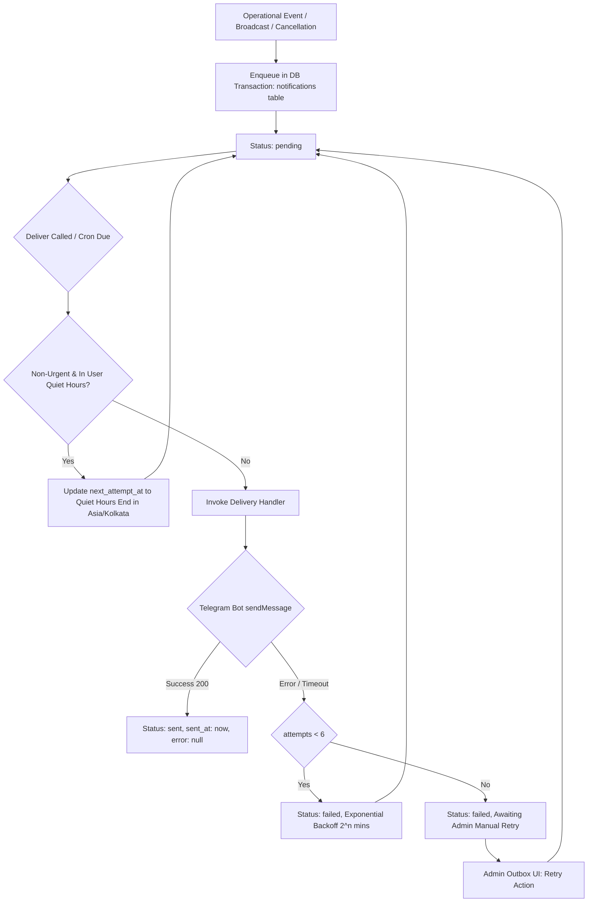
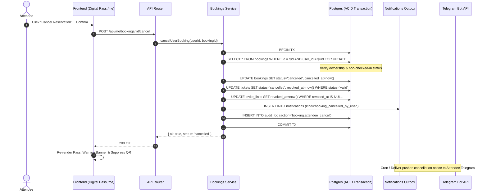

# Real-Time Notifications & Operational Comms Architecture
**Milestone:** M8 Real-time Notifications & Operational Comms  
**Target Branch:** `feature/m8-realtime-notifications`  
**Status:** Implemented & Verified

---

## 1. Overview & Objectives

Milestone M8 establishes reliable, real-time operational communications, closing critical communication and lifecycle gaps across all seven platform roles (Attendee, Host, Organiser, Venue/Business Owner, Event Staff, Service Provider, Admin/Support):

1. **Attendee Lifecycle & Cancellation:**
   - Server-authoritative attendee self-cancellation endpoint (`POST /api/me/bookings/:id/cancel` and `POST /api/bookings/:id/cancel`).
   - Transactional seat hold release, ticket invalidation, and single-use Telegram invite revocation.
   - Immediate cancellation confirmation delivery to Telegram.
   - Clear visual cancellation state with warning banner and automatic QR pass suppression.

2. **Organiser & Staff Operational Comms:**
   - Host announcement broadcasts (`POST /api/organiser/events/:id/announcements`) delivered to confirmed attendees with custom title, body, and direct booking pass deep link.
   - Event staff scoping invariant fix: event staff (including `door_staff` and `assistant`) discover and access assigned events via `event.view_inventory` without exposing sensitive attendee guest lists (`event.view_guests`).
   - Host approval workflow: when admin approves host via `setOrganiser`, automated `host_approved` notification is enqueued with direct link to the organiser workspace.

3. **Quiet Hours & Notification Delivery Engine:**
   - Per-user quiet hours configuration in `Asia/Kolkata` timezone (e.g., 23:00 to 08:00).
   - Quiet hours deferral mechanism for non-urgent notifications (`event_announcement`, non-emergency `event_update`, `event_reminder`, `membership_renewed`, `expiry_reminder`).
   - Urgent notifications (payment receipts, immediate booking cancellations, security alerts) bypass quiet hours to guarantee critical safety communication.

4. **Admin Outbox & Comms Management:**
   - Central outbox inspection API (`GET /api/admin/notifications`) with status filtering (`all`, `pending`, `failed`, `sent`) and 24h KPI statistics.
   - Manual retry mechanism (`POST /api/admin/notifications/:id/retry`) allowing support operators to re-attempt deliveries with automatic status updates.
   - Interactive lead review for host, venue, and partner applications with direct communication links (Telegram `t.me`, `mailto:`, `tel:`).

---

## 2. Notification Pipeline & State Machine

---

## 3. Attendee Self-Cancellation Specification

### 3.1 Invariants
- An attendee can only cancel their own booking (`user_id = $auth_user_id`).
- Checked-in bookings cannot be cancelled (`409 already_checked_in`).
- Already cancelled bookings reject duplicate requests (`409 already_cancelled`).
- Cancelled bookings immediately revoke:
  - Any valid tickets (`status = 'cancelled'`, `revoked_by = user_id`, `revoked_at = now()`).
  - Any unused private Telegram group invite links (`revoked_at = now()`).
- Seat capacity is automatically recovered because `SEAT_HOLDING_SQL` excludes `status = 'cancelled'`.
- Cancellation is recorded in `audit_log` with action `booking.attendee_cancel`.

### 3.2 Cancellation Sequence

---

## 4. Event Staff Scoping Architecture

To enforce the principle of least privilege while enabling operational door operations:

| Role | Scope | Permissions Granted | Can View Guest PII? | Can Scan Tickets? | Can See Assigned Event in Workspace? |
|:---|:---|:---|:---|:---|:---|
| `organiser` / Owner | Org / Event | All event actions | Yes | Yes | Yes |
| `event_manager` | Event | All event actions except ownership transfer | Yes | Yes | Yes |
| `guest_list_manager` | Event | `event.view_guests`, `event.decide_bookings`, `event.check_in`, `event.view_inventory` | Yes | Yes | Yes |
| `door_staff` | Event | `event.check_in`, `event.view_inventory` | **No** (Strictly blocked) | **Yes** | **Yes** |
| `assistant` | Event | `event.view_guests`, `event.view_inventory` | Yes | No | Yes |

### Key Resolution:
`listOrganiserEvents` and `getEventOverview` now evaluate `event.view_inventory` rather than `event.view_guests`. This guarantees door staff can access their workspace and door scanner (`/organiser/events/:id/scan`), while `listOrganiserBookings` continues to require `event.view_guests`, preventing unauthorized exposure of attendee personal data.

---

## 5. Security & Verification Summary

1. **Fail-Closed Security:** All endpoints require authenticated sessions and strict permission checks.
2. **Cryptographic Integrity:** Ticket QR payloads remain HMAC-SHA256 signed with zero personal data leakage.
3. **Audit Trail:** Every administrative and attendee state transition is immutably logged in `audit_log`.
4. **Zero Live Payments:** `ENABLE_LIVE_PAYMENTS=false` remains strictly enforced across all environments.
