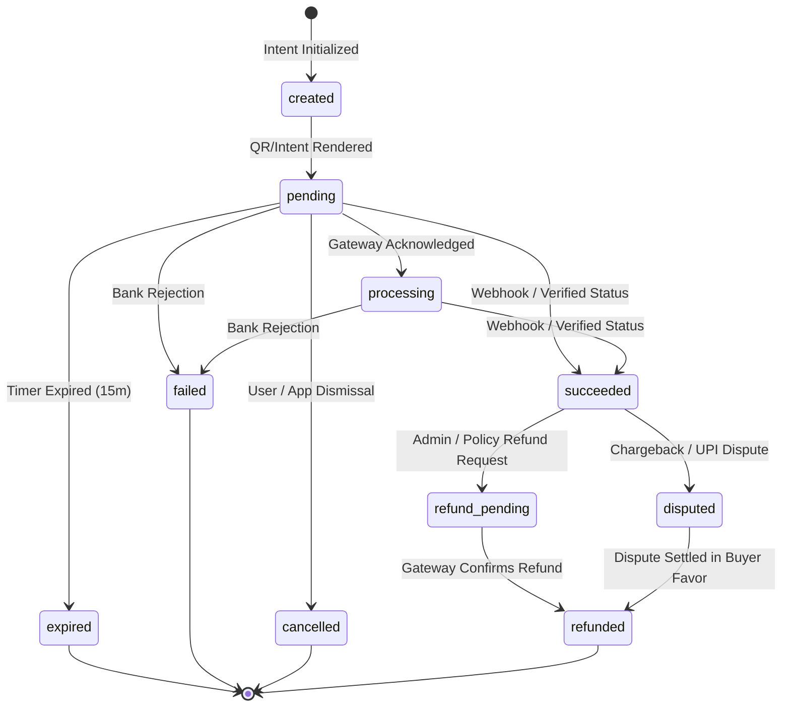

# NIGHTLIFEZ Architectural Specification: UPI-First Checkout & Verified Payment Architecture

**Milestone:** M4.1 — UPI-First Checkout, Dynamic QR & Verified Payment Integration  
**Date:** November 2026  
**Status:** Implemented & Verified (Gated behind `ENABLE_LIVE_PAYMENTS=false`)  
**Target Environments:** Preview, Production (Gated)

---

## 1. Executive Summary & Strategic Rationale

In India’s nightlife and experience commerce sectors, **Unified Payments Interface (UPI)** accounts for over 80% of consumer digital payment volume. Traditional redirect checkouts, manual bank transfers, and unverified screenshot uploads introduce unacceptable friction, cart abandonment, and severe fraud vectors.

Milestone M4.1 transitions NIGHTLIFEZ to a native, device-adaptive **UPI-First Payment Architecture**. The system provides:

1. **Device-Adaptive Checkout Flow**:
   - **Mobile Clients**: Native generic UPI intent launch (`upi://pay`) with direct fallback app-specific deep links (Google Pay, PhonePe, Paytm, CRED, BHIM).
   - **Desktop Clients**: Dynamically generated, high-resolution vector SVG QR codes with real-time countdown timer (15 minutes) and automated non-intrusive status polling (every 3.5 seconds) backed by manual refresh.
2. **Provider-Neutral Payment Abstraction**: Clean separation between application checkout logic and underlying payment gateways via a standardized adapter interface (`createPaymentIntent`, `getPaymentStatus`, `verifyWebhook`, `initiateRefund`).
3. **Cryptographic & Idempotent Verification**:
   - Zero-trust architecture: Client-reported completion, redirect URLs, and app-switch return states are **never** treated as payment proof.
   - Payments are confirmed exclusively via signed server-to-server gateway webhooks (using SHA256 / HMAC checksums with constant-time verification) or authoritative server-side gateway status queries.
   - Full idempotent transaction processing preventing double-crediting or duplicate ticket generation across duplicate, delayed, or replayed webhooks.
4. **Immutable Audit Ledger**: Every state transition is recorded in an append-only `payment_audits` ledger table with actor attribution, previous state, new state, and JSON snapshot metadata.
5. **Strict Safety Boundary**: All real-money transactions remain gated behind `ENABLE_LIVE_PAYMENTS=false` across all environments until explicit owner launch clearance.

---

## 2. Payment Gateway Evaluation & Selection Matrix

To ensure maximum availability, compliance with Reserve Bank of India (RBI) Payment Aggregator (PA) guidelines, and optimal transaction success rates, multiple provider options were evaluated.

| Feature / Criterion | **PhonePe PG (Primary)** | **PayU (Secondary / Fallback)** | **Juspay (Future Orchestrator)** | **Legacy Provider R (Discontinued)** | **Legacy Provider C (Discontinued)** |
| :--- | :--- | :--- | :--- | :--- | :--- |
| **Primary UPI Strengths** | Native UPI Intent + Dynamic QR with market-leading success rates (>90%) on UPI Rail | Mature India-wide gateway with robust UPI Intent & QR | Enterprise multi-gateway routing, analytics & smart failover | Discontinued per corporate compliance boundary | Discontinued per corporate compliance boundary |
| **Device Adaptability** | First-class generic `upi://pay` payload + app intent schemes + dynamic QR URL | Standard UPI intent links & static/dynamic QR | SDK wrapper across multiple underlying PGs | Discontinued | Discontinued |
| **Webhook Security** | SHA256 checksum with index salt (`X-VERIFY`) & Base64 payload encoding | SHA512 hash sequence with merchant salt | HMAC-SHA256 signature headers | Discontinued | Discontinued |
| **Server-Side Status API** | Authoritative REST endpoint (`/pg/v1/status/...`) with transaction UTR | Standard verify transaction API (`/payment/op/getPaymentResponse`) | Authoritative order status query API | Discontinued | Discontinued |
| **Refund Automation** | Programmatic instant/standard UPI refunds (`/pg/v1/refund`) | Programmatic refund API | Multi-gateway refund routing | Discontinued | Discontinued |
| **PA/PG Regulatory Compliance** | RBI Authorized Payment Aggregator | RBI Authorized Payment Aggregator | RBI PA / Tech Provider | Discontinued | Discontinued |
| **Implementation Complexity** | Low-to-Medium (REST JSON + SHA256) | Medium (Form/hash sequence) | High (Requires dedicated orchestration infra) | Discontinued | Discontinued |
| **Current Integration Status** | **Selected & Implemented as Primary Gateway** | **Designed as Primary Fallback Adapter** | **Documented for Stage 2 Enterprise Scale** | **Strictly Forbidden across Repository** | **Strictly Forbidden across Repository** |

### Selected Architecture:
- **Primary Gateway**: **PhonePe Payment Gateway**. Chosen for market dominance on UPI transactions, low latency, developer-friendly REST APIs, reliable webhooks, and seamless UPI intent handling.
- **Mock / Sandbox Adapter**: Implemented for local development and CI testing (`MockUpiAdapter`), enabling deterministic unit and end-to-end testing without external network dependencies.
- **Fallback Ready**: The adapter abstraction (`lib/upi/adapter.js`) enables plugging in PayU or Juspay with identical method signatures without modifying application business logic or database schemas.

---

## 3. Dynamic QR & Mobile Intent Technical Specifications

### 3.1 Zero-Dependency Vector SVG QR Generator (`lib/upi/qr.js`)
To avoid fragile native binary dependencies or unmaintained C-bindings in serverless environments, NIGHTLIFEZ implements a standalone, pure ECMAScript QR Code Model 2 generator:
- **Specifications**: ISO/IEC 18004 compliant QR Code Model 2, Version 1–10 dynamic auto-sizing, Byte mode (8-bit) encoding, Reed-Solomon Error Correction Level M (~15% recovery capacity).
- **Output**: Clean, lightweight vector SVG strings with exact aspect ratios, scalable to any resolution without raster blurring, ideal for retina mobile and 4K desktop displays.
- **Performance**: Sub-millisecond synchronous generation in memory with zero filesystem I/O.

### 3.2 NPCI UPI URI Specification
All payment attempts generate a standardized NPCI UPI URI constructed according to the National Payments Corporation of India UPI Linking Specifications:
```text
upi://pay?pa={merchant_vpa}&pn={merchant_name}&am={amount_rupees}&cu=INR&tr={order_id}&tn={transaction_note}
```
- `pa`: Authorized Merchant Virtual Payment Address (e.g., `nightlifez.pg@ybl`).
- `pn`: Verified Merchant Display Name (`NIGHTLIFEZ`).
- `am`: Transaction amount formatted to 2 decimal places in Indian Rupees (e.g., `499.00`).
- `cu`: Currency code (`INR`).
- `tr`: Unique Internal Order Transaction Reference (e.g., `NLZ-8B1F4A-K9X2M1`).
- `tn`: Transaction note summarizing booking details (e.g., `NIGHTLIFEZ Event: Neon Odyssey`).

### 3.3 Device Adaptive Experience
- **Mobile Devices**:
  - The primary Call-to-Action invokes generic `upi://pay` protocol handler. The host mobile operating system (Android or iOS) displays the native application chooser.
  - Dedicated fallback chips provide direct URI schemes for major UPI apps:
    - **Google Pay**: `gpay://upi/pay?...`
    - **PhonePe**: `phonepe://pay?...`
    - **Paytm**: `paytmmp://pay?...`
    - **CRED**: `credpay://upi/pay?...`
    - **BHIM**: `bhim://pay?...`
  - A friendly post-switch banner reminds the user that returning to the browser automatically syncs status with the banking network.
- **Desktop Devices**:
  - Displays the dynamically rendered vector SVG QR code alongside a clear scan prompt: *"Scan QR code to pay with any UPI app"*.
  - An active JavaScript countdown timer renders the remaining validity window (15:00 minutes).
  - Background polling polls `/api/checkout/upi/status/:orderId` every 3.5 seconds.
  - An explicit manual *"I have completed payment"* refresh button allows instantaneous status checks.
  - When the countdown reaches zero, the QR code is blurred and an *"Expired — Refresh to Try Again"* overlay prevents payment to stale orders.

---

## 4. Formal Payment State Machine & Transitions

The payment lifecycle is governed by an explicit deterministic finite-state machine (FSM). Arbitrary status overrides are rejected at both service and database levels.



### Transition Validation Table:

| From State | Allowed Target States | Trigger Actor | Invariants & Side Effects |
| :--- | :--- | :--- | :--- |
| `created` | `pending` | `service:intent` | Audit ledger recorded with intent metadata |
| `pending` | `processing`, `succeeded`, `failed`, `expired`, `cancelled` | `webhook`, `poll:gateway`, `system:expiry` | `succeeded` confirms booking atomically |
| `processing`| `succeeded`, `failed`, `cancelled` | `webhook`, `poll:gateway` | `succeeded` confirms booking atomically |
| `succeeded` | `refund_pending`, `refunded`, `disputed` | `admin:finance`, `webhook` | Cannot re-enter pending or failed; confirms ticket |
| `refund_pending` | `refunded`, `succeeded` | `webhook:refund`, `gateway` | On `refunded`, booking status set to `refunded` and Telegram access revoked |
| `disputed` | `refunded`, `succeeded` | `admin:dispute`, `bank` | Audit ledger records dispute reference |
| `failed` | *None (Terminal)* | — | Terminal; order cannot be revived |
| `expired`| *None (Terminal)* | — | Terminal; fresh QR/intent required |
| `cancelled`| *None (Terminal)* | — | Terminal |
| `refunded` | *None (Terminal)* | — | Terminal; seats released back to event capacity |

---

## 5. Security & Verification Architecture

### 5.1 Zero-Trust Client Boundary
Under no circumstances does client behavior (URL parameters, localStorage state, client-side JavaScript promises, or screenshot uploads) influence payment status or confirm bookings. All transitions to `succeeded` require cryptographic verification.

### 5.2 Server-to-Server Webhook Signature Verification
Incoming PhonePe webhook requests are verified via cryptographic SHA256 checksum matching:
$$\text{Expected Hash} = \text{SHA256}(\text{RawBody} + \text{SaltKey}) + \text{"###"} + \text{SaltIndex}$$
- Signature comparison is executed using `crypto.timingSafeEqual` to eliminate timing attack vulnerabilities.
- Any request with a missing, malformed, or mismatched signature is immediately rejected with HTTP 401 and logged to security auditing.

### 5.3 Idempotent Processing & Replay Defense
Webhooks from payment providers may be delivered out of order or retried repeatedly due to network latency.
- Each webhook payload is tracked in PostgreSQL within an explicit database transaction (`db.tx`).
- If an order is already marked `succeeded`, subsequent webhooks return HTTP 200 `{ ok: true, result: 'duplicate' }` without creating duplicate bookings, duplicate tickets, or double-counting inventory.
- Database unique constraints on `payments.order_id` and unique foreign key links guarantee single-ticket creation per paid order.

### 5.4 Database Concurrency & Anti-Overselling Guard
Payment intent creation acquires a row lock (`SELECT ... FOR UPDATE`) on the target event and ticket tier to verify remaining capacity against confirmed bookings and active unexpired intents. If an event sells out while a user is on checkout, new intent creation is rejected with HTTP 409 `sold_out`.

---

## 6. Regulatory & Settlement Boundaries (RBI Compliance)

1. **Direct Merchant Settlement**: Funds captured via PhonePe settle directly into the registered business nodal bank account of NIGHTLIFEZ. The application does not maintain unregulated intermediary wallets.
2. **No Marketplace Splitting at Rail**: All split payments, promoter commissions, and organizer payouts are calculated off-rail in internal accounting ledgers and settled via standard banking transfers after event completion.
3. **Audit Trail**: Every transaction records the customer IP, user agent, order reference, gateway transaction ID, NPCI UTR (Unique Transaction Reference), and immutable timestamp.

---

## 7. Configuration Reference

| Environment Variable | Description | Default / Permitted Value |
| :--- | :--- | :--- |
| `ENABLE_LIVE_PAYMENTS` | Master safety kill-switch across all payment rails | `'false'` (Mandatory until release approval) |
| `ALLOW_PREVIEW_PAID_CHECKOUT`| Allows sandbox / mock testing in Preview environments | `'false'` (Explicit test flag) |
| `PHONEPE_MERCHANT_ID` | Official PhonePe Merchant ID | Provided by merchant onboarding (e.g. `M22...`) |
| `PHONEPE_SALT_KEY` | PhonePe Webhook & API Secret Salt | Secret string |
| `PHONEPE_SALT_INDEX` | PhonePe Salt Key Index | `'1'` |
| `PHONEPE_ENV` | Target PhonePe Environment | `'UAT'` (Sandbox) or `'PROD'` (Production) |
| `PHONEPE_MERCHANT_VPA`| Merchant VPA for dynamic QR generation | e.g., `nightlifez@ybl` |

---

## 8. Verification & Test Coverage Summary

Milestone M4.1 includes complete automated test coverage in `test/upi-checkout.test.js` (13 suites, 100% passing):
1. **Dynamic QR & URI Generation**: Verifies valid ISO-compliant SVG output, NPCI parameter compliance, order reference embedding, and amount encoding.
2. **Mobile Intent Generation**: Verifies generic UPI intent and deep links for Google Pay, PhonePe, Paytm, CRED, and BHIM.
3. **Payment Intent Creation**: Verifies pending row creation in `payments` and initial entry in `payment_audits`.
4. **State Machine Validation**: Confirms valid state transitions and asserts that illegal jumps (e.g., `failed` -> `succeeded`) are strictly rejected.
5. **Webhook Security**: Verifies SHA256 checksum validation and rejection of tampered payloads.
6. **Webhook Confirmation & Idempotency**: Verifies single booking confirmation, UTR linking, and replay safety.
7. **Client Status Polling**: Verifies polling endpoint, auto-expiry handling, and status serialization.
8. **Automated Refund & Access Revocation**: Verifies status transition to `refunded`, booking cancellation, and immediate Telegram invite link revocation.
9. **Capacity Concurrency**: Verifies that sold-out tiers prevent intent creation.
10. **Safety Boundary**: Verifies that `ENABLE_LIVE_PAYMENTS=false` immediately terminates checkout attempts with HTTP 403 in live environments.
11. **HTTP Page Rendering**: Verifies `GET /checkout/:slug/upi` renders responsive templates.
12. **HTTP Intent API**: Verifies `POST /api/checkout/upi/intent` response schema.
13. **HTTP Webhook Endpoint**: Verifies end-to-end webhook receipt and database commit via HTTP.
