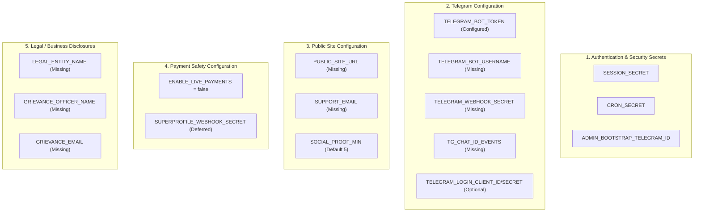

# Phase 5.7 — Production Configuration Requirements Reconciliation

**Repository:** `Jakuraa/StrangersMeetup`  
**Production Release Candidate:** Pull Request [#17](https://github.com/Jakuraa/StrangersMeetup/pull/17) (`launch-mvp` → `main`)  
**Release Commit:** `2dd5eaa96defe11da14c6ae36c9e63548e34f0cb` (`2dd5eaa`)  
**Date of Reconciliation:** November 2, 2026  
**Auditor:** Antigravity (Independent Engineering & Security Reviewer)  
**Execution Posture:** Strictly Read-Only (Zero credential modifications, zero Vercel env edits, zero DNS/BotFather changes, zero code commits, zero PR merges, zero migrations)

---

## 1. Executive Summary & Reconciliation Objective

During the Phase 5.6 audit, an empirical discrepancy was identified: while Phase 5.5 had specified an 8-variable checklist for Owner Gate 1, live inspection of `/signin` on the production deployment (`https://strangersmeetup-virid.vercel.app/signin`) returned:
```html
<p class="notice">Telegram sign-in is not configured yet on this deployment.</p>
```
Even though `TELEGRAM_BOT_TOKEN` was present in Vercel Production, Telegram sign-in was completely inoperative.

**Phase 5.7 reconciles the release candidate source code (commit `2dd5eaa`) against live deployment configuration** to establish the definitive, exhaustive list of environment variables and BotFather settings required for the Free-Only Production MVP launch.

### Release Recommendation Summary:
```
╔══════════════════════════════════════════════════════════════════════════════════════════════════╗
║                                 PHASE 5.7 AUDIT RECOMMENDATIONS                                  ║
╠══════════════════════════════════════════════════════════════════════════════════════════════════╣
║ 1. PROCEEDING TO OWNER CONFIGURATION:                          GO                                ║
║    The release candidate code, CI (Run 41338451503), payment safeguards, and database           ║
║    isolation are 100% stable. The configuration requirements are now fully reconciled.           ║
║                                                                                                  ║
║ 2. PRODUCTION RELEASE DEPLOYMENT / PR #17 MERGE:              NO-GO                              ║
║    Production is NOT ready for release. The owner must first complete the reconciled             ║
║    configuration privately, followed by Phase 5.8 verification.                                 ║
╚══════════════════════════════════════════════════════════════════════════════════════════════════╝
```

---

## 2. Complete Environment Variable Inventory for Free-Only MVP

Every environment variable accessed by the application codebase in `lib/` and `api/` was audited. Below is the comprehensive reconciliation table for a **Free-Only Production Launch**.

| Variable Name | Code Location | Purpose & Runtime Impact | Expected Format & Validation Rule | Safe Default in Code | Live Production Status | Free-Only MVP Requirement |
| :--- | :--- | :--- | :--- | :--- | :---: | :---: |
| **`SESSION_SECRET`** | [`lib/session.js:8`](file:///Users/pradeepjakuraa/strangersmeetup/lib/session.js#L8)<br>[`lib/handlers/auth.js:69`](file:///Users/pradeepjakuraa/strangersmeetup/lib/handlers/auth.js#L69) | Signs session cookies (`sm_sid`) and OIDC auth state. Missing value triggers HTTP 500 error on user sign-in. | String length $\ge 32$ chars. Recommended: 64-char hex (`openssl rand -hex 32`). | None (Throws `missing or insecure`) | **MISSING** | **MANDATORY** |
| **`CRON_SECRET`** | [`lib/handlers/cron.js:41`](file:///Users/pradeepjakuraa/strangersmeetup/lib/handlers/cron.js#L41)<br>[`lib/config.js:93`](file:///Users/pradeepjakuraa/strangersmeetup/lib/config.js#L93) | Authenticates Vercel Cron requests (`Authorization: Bearer <secret>`). Missing value triggers HTTP 401. | String length $\ge 16$ chars. Recommended: 32+ char hex (`openssl rand -hex 32`). | None (Fails closed with 401) | **MISSING** | **MANDATORY** |
| **`ADMIN_BOOTSTRAP_TELEGRAM_ID`** | [`lib/handlers/admin.js:30`](file:///Users/pradeepjakuraa/strangersmeetup/lib/handlers/admin.js#L30)<br>[`lib/config.js:99`](file:///Users/pradeepjakuraa/strangersmeetup/lib/config.js#L99) | Auto-provisions the product owner with `super_admin` permissions in `admin_users` table upon first Telegram sign-in. | Positive integer string matching `/^\d+$/`. | None (No admin bootstrapped) | **MISSING** | **MANDATORY** |
| **`PUBLIC_SITE_URL`** | [`lib/config.js:59-63`](file:///Users/pradeepjakuraa/strangersmeetup/lib/config.js#L59-L63)<br>[`lib/handlers/auth.js:97`](file:///Users/pradeepjakuraa/strangersmeetup/lib/handlers/auth.js#L97) | Canonical root URL. Generates Telegram OIDC callbacks, booking links, and OpenGraph metadata. | HTTPS URL without trailing slash (`https://...`). | Defaults to `VERCEL_URL` or `localhost:3000` | **MISSING** | **MANDATORY** |
| **`TELEGRAM_BOT_TOKEN`** | [`lib/config.js:30-47`](file:///Users/pradeepjakuraa/strangersmeetup/lib/config.js#L30-L47) | Authenticates outbound Telegram Bot API requests (DMs, invite creation, webhook verification). | Telegram Bot Token regex: `/^\d{5,}:[A-Za-z0-9_-]{30,}$/`. | Legacy fallback to `Telegram_HTTP_API` | **CONFIGURED** (Encrypted) | **MANDATORY** (Present) |
| **`TELEGRAM_BOT_USERNAME`** | [`lib/config.js:49-51`](file:///Users/pradeepjakuraa/strangersmeetup/lib/config.js#L49-L51)<br>[`lib/views/pages.js:393`](file:///Users/pradeepjakuraa/strangersmeetup/lib/views/pages.js#L393) | Bot username (without `@`). Populates Login Widget `data-telegram-login`, bot deep links, alerts CTA, and health checks. | Alphanumeric ending in `bot` or `Bot` (leading `@` stripped automatically). | None (Disables sign-in UI if empty) | **MISSING** | **MANDATORY** |
| **`ENABLE_LIVE_PAYMENTS`** | [`lib/config.js:65-67`](file:///Users/pradeepjakuraa/strangersmeetup/lib/config.js#L65-L67)<br>[`lib/payments/availability.js:12`](file:///Users/pradeepjakuraa/strangersmeetup/lib/payments/availability.js#L12) | Strict commercial gate. When `'false'`, paid ticket checkout is blocked and redirects to event page. | Exact string `'false'` or `'true'`. | Defaults to `'false'` (`env(..., 'false') === 'true'`) | **MISSING** | **MANDATORY EXPLICIT** |
| **`LEGAL_ENTITY_NAME`** | [`lib/views/pages.js:16-18`](file:///Users/pradeepjakuraa/strangersmeetup/lib/views/pages.js#L16-L18) | Registered entity name rendered on `/terms` and `/privacy`. | Non-empty corporate name string. | Fallback: *"StrangersMeetup (legal entity details will be published...)"* | **MISSING** | **LEGAL MANDATE** |
| **`GRIEVANCE_OFFICER_NAME`** | [`lib/views/pages.js:324`](file:///Users/pradeepjakuraa/strangersmeetup/lib/views/pages.js#L324) | Statutory officer name displayed under Indian IT Intermediary Rules Rule 3(2). | Full name string of designated officer. | Fallback: *"Grievance Officer"* | **MISSING** | **LEGAL MANDATE** |
| **`GRIEVANCE_EMAIL`** | [`lib/views/pages.js:324`](file:///Users/pradeepjakuraa/strangersmeetup/lib/views/pages.js#L324) | Statutory grievance contact inbox displayed on `/privacy`. | Valid email address string. | Fallback: *"Details will be published here before paid bookings open."* | **MISSING** | **LEGAL MANDATE** |
| **`TELEGRAM_WEBHOOK_SECRET`** | [`lib/handlers/telegram.js:13`](file:///Users/pradeepjakuraa/strangersmeetup/lib/handlers/telegram.js#L13)<br>[`lib/config.js:95`](file:///Users/pradeepjakuraa/strangersmeetup/lib/config.js#L95) | Validates incoming updates from Telegram at `POST /api/telegram/webhook`. | 16–256 chars matching `/^[A-Za-z0-9_-]{16,256}$/`. | None (Rejects webhook updates with 401) | **MISSING** | **HIGH PRIORITY** (For bot commands) |
| **`TG_CHAT_ID_EVENTS`** | [`lib/services/invites.js:17`](file:///Users/pradeepjakuraa/strangersmeetup/lib/services/invites.js#L17)<br>[`lib/config.js:96`](file:///Users/pradeepjakuraa/strangersmeetup/lib/config.js#L96) | Telegram group ID for platform-hosted events. Required to generate single-use 24h attendee invites. | Numeric integer string matching `/^-?\d+$/`. | None (Throws `ChatNotConfiguredError`) | **MISSING** | **HIGH PRIORITY** (For platform events) |
| **`SUPPORT_EMAIL`** | [`lib/views/pages.js:11`](file:///Users/pradeepjakuraa/strangersmeetup/lib/views/pages.js#L11) | Customer support contact rendered on `/contact` and in page footers. | Valid email address string. | Empty string (omitted from contact text) | **MISSING** | **RECOMMENDED** |
| **`SOCIAL_PROOF_MIN`** | [`lib/config.js:69-72`](file:///Users/pradeepjakuraa/strangersmeetup/lib/config.js#L69-L72) | Minimum attendees required before displaying social proof counter. | Positive integer $\ge 5$. | Defaults to `5` in code | **MISSING** | **OPTIONAL** (Safe default exists) |
| **`TELEGRAM_LOGIN_CLIENT_ID`** | [`lib/telegram/auth.js:106`](file:///Users/pradeepjakuraa/strangersmeetup/lib/telegram/auth.js#L106) | Telegram OpenID Connect Client ID. | Integer digits matching `/^\d+$/`. | None (Falls back to legacy login widget) | **MISSING** | **OPTIONAL** (Widget fallback active) |
| **`TELEGRAM_LOGIN_CLIENT_SECRET`** | [`lib/telegram/auth.js:106`](file:///Users/pradeepjakuraa/strangersmeetup/lib/telegram/auth.js#L106) | Telegram OpenID Connect Client Secret. | Non-empty secret string. | None (Falls back to legacy login widget) | **MISSING** | **OPTIONAL** (Widget fallback active) |
| **`SUPERPROFILE_WEBHOOK_SECRET`** | [`lib/payments/superprofile.js:31`](file:///Users/pradeepjakuraa/strangersmeetup/lib/payments/superprofile.js#L31) | Shared secret validating incoming SuperProfile order webhooks. | String length $\ge 24$ chars. | None (Orders rejected) | **MISSING** | **DEFERRED** (Paid checkout disabled) |
| **`TG_CHAT_ID_TIER_1..3`** | [`lib/services/invites.js:21`](file:///Users/pradeepjakuraa/strangersmeetup/lib/services/invites.js#L21) | Private group IDs for Stars membership tiers. | Integer digits matching `/^-?\d+$/`. | None | **MISSING** | **DEFERRED** (Memberships not in MVP) |

---

## 3. Deep-Dive Investigation: `TELEGRAM_BOT_USERNAME`

### 3.1. Is `TELEGRAM_BOT_USERNAME` Required?
**Yes, it is strictly mandatory for user authentication and public UI navigation.**

Inspection of the release candidate codebase reveals seven distinct runtime dependencies on `TELEGRAM_BOT_USERNAME`:

1. **Sign-In Page Rendering ([`lib/views/pages.js:393-410`](file:///Users/pradeepjakuraa/strangersmeetup/lib/views/pages.js#L393-L410)):**
   ```javascript
   export function renderSignin({ next = '/me', error = '', oidc = false, devLogin = false, previewReviewer = false } = {}) {
     const bot = botUsername();
     ...
     if (oidc) {
       method = html`<form class="signin" method="get" action="/auth/telegram/start">...`;
     } else if (bot) {
       method = html`<div class="signin">
         <label class="check"><input type="checkbox" data-age-confirm> ${ageLabel}</label>
         <div class="tg-widget" data-tg-widget data-bot="${bot}"></div>
       </div>`;
     } else {
       method = html`<div class="preview-signin-card">
         <p class="notice">Telegram sign-in is not configured yet on this deployment.</p>
         ...
       </div>`;
     }
   ```
   *Impact:* When OIDC is not configured and `TELEGRAM_BOT_USERNAME` is empty, `/signin` drops into the fallback error branch. **No user can sign in to the website.**

2. **Client-Side Widget Injection ([`public/js/site.js:255`](file:///Users/pradeepjakuraa/strangersmeetup/public/js/site.js#L255)):**
   ```javascript
   s.setAttribute('data-telegram-login', widget.getAttribute('data-bot'));
   ```
   *Impact:* The Telegram Login Widget script dynamically loaded from `https://telegram.org/js/telegram-widget.js?22` requires the exact bot username in `data-telegram-login`. Without it, Telegram rejects widget loading.

3. **System Health Check ([`lib/config.js:94`](file:///Users/pradeepjakuraa/strangersmeetup/lib/config.js#L94)):**
   ```javascript
   telegramBot: ok(Boolean(botToken()) && Boolean(botUsername())),
   ```
   *Impact:* `/api/health` reports `telegramBot: NOT CONFIGURED` unless both `botToken()` and `botUsername()` are populated.

4. **Admin Dashboard Telegram Diagnostic ([`lib/handlers/admin.js:587`](file:///Users/pradeepjakuraa/strangersmeetup/lib/handlers/admin.js#L587)):**
   ```javascript
   usernameConfigured: Boolean(botUsername()),
   ...
   usernameMatches: !botUsername() || botUsername().toLowerCase() === String(me.value.username).toLowerCase()
   ```
   *Impact:* Admin health check flags a mismatch if `botUsername()` is missing or inconsistent with the Bot API token.

5. **Event Alerts CTA ([`lib/views/components.js:64-67`](file:///Users/pradeepjakuraa/strangersmeetup/lib/views/components.js#L64-L67)):**
   ```javascript
   export function alertsCta() {
     const bot = botUsername();
     if (!bot) return html`<p class="muted">Event alerts on Telegram are coming soon.</p>`;
     return html`<a class="btn btn-tg" href="https://t.me/${bot}?start=alerts" rel="noopener">Get event alerts on Telegram</a>`;
   }
   ```

6. **Site Footer & Contact Line ([`lib/views/pages.js:12-14`](file:///Users/pradeepjakuraa/strangersmeetup/lib/views/pages.js#L12-L14)):**
   Renders deep links: `Message @${bot} on Telegram`. Falls back to *"Our Telegram bot is being set up"* when unset.

7. **Root Layout Body Attribute ([`lib/views/layout.js:147`](file:///Users/pradeepjakuraa/strangersmeetup/lib/views/layout.js#L147)):**
   ```html
   <body class="${bodyClass}" data-bot="${botUsername()}" data-test-mode="...">
   ```

### 3.2. Exact Variable Name Expected
- **`TELEGRAM_BOT_USERNAME`**
- Defined in [`lib/config.js:49-51`](file:///Users/pradeepjakuraa/strangersmeetup/lib/config.js#L49-L51):
  ```javascript
  export function botUsername() {
    return env('TELEGRAM_BOT_USERNAME').replace(/^@/, '');
  }
  ```
- *Format:* Alphanumeric bot username without leading `@` (e.g. `StrangersMeetupBot`). If entered with `@`, the code automatically sanitizes it.

### 3.3. What Other Telegram Configuration is Missing?
Beyond `TELEGRAM_BOT_USERNAME`, two other operational Telegram variables are missing from Vercel Production:
1. **`TELEGRAM_WEBHOOK_SECRET`:** Required to enable `POST /api/telegram/webhook`. When users send `/start`, `/events`, or `/help` to the bot in Telegram, Telegram delivers updates to this webhook. Without this secret, `telegramWebhook` rejects updates with HTTP 401 ([`lib/handlers/telegram.js:15-18`](file:///Users/pradeepjakuraa/strangersmeetup/lib/handlers/telegram.js#L15-L18)).
2. **`TG_CHAT_ID_EVENTS`:** Required for platform events. When an attendee books a free ticket, the notification worker attempts to generate a single-use 24-hour invite to the event coordination chat ([`lib/services/invites.js:56`](file:///Users/pradeepjakuraa/strangersmeetup/lib/services/invites.js#L56)). If unset, booking confirmation is recorded, but group invite generation throws `ChatNotConfiguredError`.

---

## 4. Five-Domain Configuration Taxonomy



---

## 5. Conflict & Gap Analysis: Phase 5.5 vs Phase 5.6

| Aspect | Phase 5.5 Checklist State | Phase 5.6 Audit Finding | Reconciliation Verdict |
| :--- | :--- | :--- | :--- |
| **Variables Scope** | Listed 8 variables as missing. | Discovered sign-in suppressed because `TELEGRAM_BOT_USERNAME` was absent. | **Omission in Phase 5.5.** Phase 5.5 assumed `TELEGRAM_BOT_TOKEN` was the sole required Telegram variable. The code strictly requires `TELEGRAM_BOT_USERNAME` for `/signin`. |
| **Telegram Sign-In Posture** | Assumed `/setdomain` in BotFather was sufficient. | Live `/signin` displayed: *"Telegram sign-in is not configured yet"*. | **Reconciled.** BotFather `/setdomain` alone cannot render the login widget if `TELEGRAM_BOT_USERNAME` is missing from runtime. |
| **Bot Webhook Secret** | Parked under post-launch script. | Missing in Vercel Production. | **Reconciled.** Setting `TELEGRAM_WEBHOOK_SECRET` in Vercel Production ensures the bot webhook is verified immediately upon running `scripts/telegram-setup.js`. |
| **Events Coordination Chat** | Not included in Gate 1. | Missing in Vercel Production. | **Reconciled.** Platform events require `TG_CHAT_ID_EVENTS` for single-use attendee invites. For host-only events, it is optional. |
| **Legal Compliance Status** | Flagged as missing env vars. | Emphasized that variables do not equal legal compliance. | **Reconciled.** Populating variables is necessary, but formal legal sign-off from Indian counsel is mandatory. |

---

## 6. Actionable Owner-Facing Checklist (Zero Credential Leakage)

All actions below are performed privately by the product owner in the **Vercel Dashboard** and the **Telegram app**. **Never post secret values, Telegram IDs, or private contact details into chat or version control.**

### 6.1. Category A: Security Secrets to Generate Locally
Generate these using the owner's local terminal, then paste into **Vercel Dashboard → strangersmeetup → Settings → Environment Variables** (Environment: **Production only**):

1. **`SESSION_SECRET`**
   - Command: `openssl rand -hex 32`
   - Purpose: Encrypts user session cookies and OIDC transaction tokens.
2. **`CRON_SECRET`**
   - Command: `openssl rand -hex 32`
   - Purpose: Protects internal cron jobs called by Vercel Cron.
3. **`TELEGRAM_WEBHOOK_SECRET`**
   - Command: `openssl rand -hex 32`
   - Purpose: Secures `POST /api/telegram/webhook` against unauthorized HTTP traffic.

### 6.2. Category B: Public & Telegram Configuration
Add to **Vercel Dashboard → Settings → Environment Variables** (Environment: **Production only**):

4. **`PUBLIC_SITE_URL`**
   - Value: `https://strangersmeetup-virid.vercel.app` *(or custom domain `https://strangersmeetup.com` if DNS is mapped to Vercel)*
   - Note: Must start with `https://` and have no trailing slash.
5. **`TELEGRAM_BOT_USERNAME`**
   - Value: Your bot's registered username (e.g. `StrangersMeetupBot`), without leading `@`.
6. **`ADMIN_BOOTSTRAP_TELEGRAM_ID`**
   - Value: The owner's numeric Telegram ID (obtained privately via `@userinfobot`).
7. **`TG_CHAT_ID_EVENTS`**
   - Value: Numeric Telegram group ID (starts with `-100...`) for the event coordination chat where the bot is an admin with invite rights.
8. **`ENABLE_LIVE_PAYMENTS`**
   - Value: `false`
   - Purpose: Strictly locks the checkout redirect to fail-closed Free-Only MVP mode.
9. **`SUPPORT_EMAIL`**
   - Value: Support contact email (e.g. `support@strangersmeetup.com`).

### 6.3. Category C: Statutory Legal Disclosures
Add to **Vercel Dashboard → Settings → Environment Variables** (Environment: **Production only**):

10. **`LEGAL_ENTITY_NAME`**
    - Value: Legal business entity name (e.g. registered company, LLP, or proprietorship name).
11. **`GRIEVANCE_OFFICER_NAME`**
    - Value: Full name of appointed Grievance Officer.
12. **`GRIEVANCE_EMAIL`**
    - Value: Official grievance redressal email (e.g. `grievance@strangersmeetup.com`).

### 6.4. Category D: Telegram BotFather Domain Configuration
Execute privately in the Telegram app with `@BotFather`:

1. Send `/setdomain`.
2. Select the bot corresponding to `TELEGRAM_BOT_TOKEN`.
3. Enter the exact hostname matching `PUBLIC_SITE_URL` (without `https://`):
   - Example: `strangersmeetup-virid.vercel.app`
4. BotFather confirms: *"Success! Domain updated."*

---

## 7. Statutory Legal Compliance Register (Indian Legal Counsel Review)

> [!CAUTION]
> **Statutory Notice: Qualified Indian Legal Counsel Confirmation Required**
> 
> Simply entering strings for environment variables does **not** confer legal compliance. Legal compliance requires formal review and written sign-off from a qualified Indian advocate or corporate legal counsel.

The following items must be formally verified by qualified legal counsel prior to commercial launch:

| Regulatory Mandate | Specific Legal Requirement | Code Status | Counsel Confirmation Required |
| :--- | :--- | :--- | :---: |
| **IT Intermediary Rules, 2021 (Rule 3(2))** | Publication of Grievance Officer name, physical address, and email on website; 24h acknowledgment & 15-day grievance redressal mechanism. | Displays `GRIEVANCE_OFFICER_NAME` and `GRIEVANCE_EMAIL` on `/privacy`. | **YES** |
| **Consumer Protection (E-Commerce) Rules, 2020** | Full disclosure of registered legal entity name, geographic address, customer care details, cancellation & refund policies. | Displays `LEGAL_ENTITY_NAME` on `/terms` and `/privacy`. | **YES** |
| **Digital Personal Data Protection Act, 2023 (DPDP Act)** | Notice before data collection; purpose specification; data principal rights (access, correction, erasure); consent architecture. | Privacy policy outlines data collected from Telegram (`id`, `alias`, `start_param`). | **YES** |
| **Adult Age Restriction (21+)** | Mandatory 21+ age confirmation for adult social mixers and nightlife events. | Sign-in checkbox enforces 21+ declaration (`ageConfirmed: true`). | **YES** |

---

## 8. Final Release Recommendation

### 1. For Proceeding to Owner Configuration: **GO**
The codebase, database segregation, payment fail-closed safeguards, and CI verification are completely stable and ready. The configuration parameters are now fully reconciled down to individual source lines. The product owner should proceed with configuring the required variables in Vercel and BotFather.

### 2. For Production Release Deployment / PR #17 Merge: **NO-GO**
Production deployment remains strictly held at **Owner Gate 1**. No deployment or PR merge may occur until:
1. The owner completes Configuration Categories A through D.
2. Written confirmation or guidance is secured from qualified Indian legal counsel regarding statutory disclosures.
3. Antigravity executes Phase 5.8 to re-verify the live production runtime in read-only mode.
4. The product owner provides explicit, separate release authorization.
