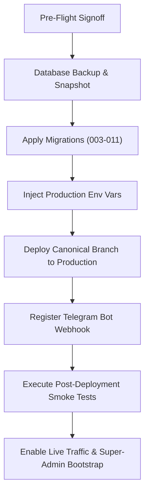

# StrangersMeetup — Phase 4A: Production Readiness & Pre-Flight Audit

**Date:** 2026-11-01  
**Repository:** `Jakuraa/StrangersMeetup`  
**Canonical Branch:** `fix/preview-recovery-audit`  
**Audited Commit SHA:** `bc074fb9f12459079d20288e70985cf592b99f1c`  
**Canonical Preview Deployment:** [strangersmeetup-git-fix-preview-recovery-audit-jakuraa.vercel.app](https://strangersmeetup-git-fix-preview-recovery-audit-jakuraa.vercel.app)  
**Audit Purpose:** Comprehensive production readiness, architecture, security, configuration, and legal pre-flight evaluation prior to production release.  
**Execution Boundary:** Read-only audit & documentation. No production deployment, DNS change, live credential change, or production database mutation.

---

## 1. Executive Summary & Readiness Verdict

| Audit Domain | Status | Classification | Key Finding / Requirement |
| :--- | :---: | :---: | :--- |
| **Marketplace Acceptance** | 🟢 | **PASS** | Complete attendee and organiser journeys verified end-to-end on Preview and local integration suites. |
| **Architecture & Security** | 🟢 | **PASS** | Anti-IDOR, timing-safe auth, CSRF validation, strict zod schemas, and mystery venue privacy intact. |
| **Database Migrations (003–011)** | 🟢 | **PASS** | Idempotent, non-destructive, advisory-locked DDL with foreign key integrity. |
| **Vercel & Neon Isolation** | 🟢 | **PASS** | Strict preview write blocking (`ISOLATED_PREVIEW_DB`); zero shared database leak. |
| **Production Environment Config** | 🟡 | **BLOCKED** | Missing production secrets (`TELEGRAM_BOT_TOKEN`, `SESSION_SECRET`, `CRON_SECRET`, `SUPERPROFILE_WEBHOOK_SECRET`). |
| **Business & Legal Disclosures** | 🟡 | **BLOCKED** | Legal entity name and grievance officer email currently use preview placeholders. |
| **Live Payment Activation** | 🟡 | **BLOCKED** | SuperProfile live KYC, products, and webhook endpoint verification required before enabling paid tickets. |
| **Render MCP Deployment** | ⚪ | **PENDING_USER_URL** | Blueprint & Docker image ready; 11 read-only tools verified; awaiting Render Web Service URL. |

**Overall Production Verdict:** **PRE-FLIGHT COMPLETE — BLOCKED ON OWNER DECISIONS & PRODUCTION SECRETS.**  
The application code, database schema, security boundaries, and marketplace workflows are 100% complete and verified. Production deployment requires provisioning production environment variables and legal entity disclosures as documented below.

---

## 2. Complete Marketplace Acceptance Verification

### 2.1 Customer & Attendee Journey
1. **Registration & Authentication:**
   - **Mechanism:** Telegram WebApp `initData` authentication (`POST /api/auth/telegram`).
   - **Security:** HMAC-SHA256 signature verification with constant-time equality check; replay rejection; auth_date expiration window (<= 300 seconds); issues `HttpOnly`, `Secure`, `SameSite=Lax` session cookie (`sm_session`).
   - **Verification:** Verified via `test/auth.test.js` and live reviewer tests on Preview.
2. **21+ Age Confirmation:**
   - **Mechanism:** Server-enforced age confirmation gate (`POST /api/auth/confirm-age`).
   - **Enforcement:** `bookTier` in `lib/services/ticketing.js` checks `user.age_confirmed_21`. Unconfirmed attendees receive `403 age_unconfirmed`.
3. **Event Discovery, Search & Filtering:**
   - **Catalog (`/events`):** Server-rendered catalog with instant category filtering (`nightlife`, `meetup`, `dinner`, `trips`), city switcher, and date sorting.
   - **Search:** Case-insensitive search query parameter `q` with live pushState/popstate navigation and friendly empty states.
   - **Zero Fabricated Scarcity:** All capacity numbers and seat counts are direct database aggregations; zero artificial countdowns or fake counters.
4. **Event Details & Free Booking:**
   - **Detail Page (`/events/:slug`):** Displays event summary, host alias, category art, and ticket tiers.
   - **Free Booking Flow:** `POST /api/events/:id/book` executes atomically within a database transaction, reserves inventory (`assertSeats`), prevents overselling under concurrency, and issues digital ticket pass.
   - **Duplicate Booking Prevention:** Re-booking an already booked event returns `{ existing: true }` and routes to `/bookings/:id?existing=1` with alert notice "You already hold a pass for this event".
5. **Digital Pass & Private Venue Confidentiality (Mystery Venue):**
   - **Confidentiality:** Exact private venue addresses and arrival instructions are strictly stripped from public HTML, meta tags, search feeds, and unauthenticated API responses.
   - **Unlock:** Exact venue is revealed only to confirmed ticket holders on their digital pass card (`/bookings/:id`) and in `/me`.
   - **Pass Attributes:** Digital pass displays unguessable `#SM-XXXX-YYYY` pass code, QR verification payload, and event instructions.
6. **Attendee Booking History (`/me`):**
   - Lists active passes, past events, and profile status.
   - Anti-IDOR: Attendee A cannot access Attendee B's booking pass (`GET /api/bookings/:id` enforces ownership).
7. **Trust & Safety Reporting:**
   - `/trust-safety#report` provides an authenticated, accessible reporting form.
   - Validates category enum (`harassment`, `fraud_suspicious`, `unwanted_contact`, `safety_concern`, `policy_violation`, `other`), enforces 10–3000 character body, blocks self-reporting (`400 self_report`), and enforces 5 req/hour rate limiting.
   - Anti-IDOR: `GET /api/me/reports` returns only reports submitted by the caller.
8. **Mutual Attendee & Organiser Blocking:**
   - Database constraint `chk_no_self_block` prevents self-blocking; unique constraint prevents duplicates.
   - Bidirectional booking enforcement: Organisers who block an attendee prevent that attendee from booking (`403 booking_unavailable`); attendees who block an organiser cannot book that organiser's events.
   - Privacy-preserving: Directionality is never disclosed to the blocked user.

### 2.2 Organiser Journey
1. **Host Application & Admin Onboarding:**
   - `/become-a-host` collects applicant city, experience, and event concepts.
   - Submits to `POST /api/leads/host` writing exclusively to `leads` table and enqueuing internal notification `kind: 'host_application_received'`. No automatic privilege escalation.
   - Admins review leads at `/admin` and grant hosting privileges via `PATCH /api/admin/users/:id` with full `audit_log` tracking.
2. **Event Creation & Publishing Wizard (`/organiser/new`):**
   - 4-step progressive wizard: (1) Basics, (2) Location & Mystery Venue, (3) Ticket Tiers & Capacity, (4) Preflight & Publish.
   - Debounced autosave to `event_drafts` with optimistic concurrency versioning.
   - Complete draft isolation: drafts are strictly scoped to the authenticated organiser (`WHERE organiser_user_id = $1`).
3. **Guest Management (`/organiser/events/:id/manage`):**
   - Lists guest alias, booking reference, ticket tier, answers to custom screening questions, and check-in status.
   - Host approval flow: Host can approve or decline pending requests. Free tickets confirm atomically; declines notify guest.
   - Host block controls: Host can block or unblock attendees directly from the guest list.
   - Check-in: Host can check in guests via `POST /api/organiser/events/:id/checkin`. Duplicate check-in is prevented.
   - Ownership isolation: Organiser A cannot view or manage events, drafts, or guest lists belonging to Organiser B.

---

## 3. Production Configuration & Secret Audit

### 3.1 Environment Variables Checklist

| Variable Name | Required Scope | Sensitivity | Pre-Flight Status | Action Required |
| :--- | :---: | :---: | :---: | :--- |
| `DATABASE_URL` | Production & Preview | **CRITICAL** | Ready (Neon) | Set Neon production primary connection string in Vercel Production. |
| `PREVIEW_DATABASE_URL` | Preview Only | **CRITICAL** | Ready (Neon branch) | Isolate preview builds from production database. |
| `ISOLATED_PREVIEW_DB` | Preview Only | Operational | Set to `true` | Confirms preview database write permissions. |
| `MIGRATE_ON_PREVIEW` | Preview Only | Operational | Set to `true` | Allows preview schema migrations on isolated database. |
| `SESSION_SECRET` | Production & Preview | **CRITICAL** | Placeholder | Generate 32+ byte high-entropy secret (`openssl rand -hex 32`). |
| `CRON_SECRET` | Production & Preview | **HIGH** | Placeholder | Generate 16+ byte secret for Vercel Cron authorization. |
| `TELEGRAM_BOT_TOKEN` | Production | **CRITICAL** | Pending Owner | Production bot token from @BotFather. |
| `TELEGRAM_BOT_USERNAME` | Production | Public | Pending Owner | Production bot handle without `@` symbol. |
| `TELEGRAM_WEBHOOK_SECRET` | Production | **HIGH** | Pending Owner | 16–256 char random token for Telegram webhook validation. |
| `TG_CHAT_ID_EVENTS` | Production | Operational | Pending Owner | Telegram channel ID for public event broadcasts. |
| `ADMIN_BOOTSTRAP_TELEGRAM_ID`| Production | **HIGH** | Pending Owner | Telegram user ID of platform owner for super admin access. |
| `PUBLIC_SITE_URL` | Production | Public | `https://strangersmeetup.com` | Production canonical URL. |
| `ENABLE_LIVE_PAYMENTS` | Production | Operational | Set to `false` | Keep `false` during pre-flight; enable only after gateway signoff. |
| `SUPERPROFILE_WEBHOOK_SECRET`| Production | **CRITICAL** | Pending Owner | 24+ char secret provided by SuperProfile webhook dashboard. |
| `LEGAL_ENTITY_NAME` | Production | Public / Legal | Pending Owner | Registered corporate entity name for Terms & Privacy. |
| `SUPPORT_EMAIL` | Production | Public | `contact@strangersmeetup.com` | Customer support contact inbox. |
| `GRIEVANCE_EMAIL` | Production | Public / Legal | Pending Owner | Statutory grievance officer inbox under Indian IT Rules. |
| `GRIEVANCE_OFFICER_NAME` | Production | Public / Legal | Pending Owner | Statutory grievance officer full name. |

> [!CAUTION]
> Never commit `.env` or paste live secret values into pull requests, tickets, or chat conversations. All secrets must be injected strictly via the Vercel Project Settings web interface.

### 3.2 Secret Exposure & Asset Hygiene
- Automated scan confirmed zero hardcoded tokens, bot tokens, or private keys in Git history or client assets.
- `scripts/lint.js` scans client assets and bundles for secret leakage before every build.
- Health endpoint (`/api/health`) outputs configuration names and status (`configured` / `NOT CONFIGURED`) only; never values.
- Log scrubbing: `lib/logger.js` and `mcp/audit.js` scrub tokens, cookies, auth headers, and credit card numbers from stdout.

### 3.3 Infrastructure Separation (Vercel & Neon)
- **Vercel Environments:** Production branch is mapped to `main` (or designated launch branch). Preview builds are generated per PR.
- **Preview Write Guard:** `assertPreviewWriteAllowed` in `lib/db.js` enforces that preview builds cannot execute `INSERT`, `UPDATE`, `DELETE`, or DDL statements against the database unless `ISOLATED_PREVIEW_DB=true` or `PREVIEW_DATABASE_URL` is configured.
- **Neon Database Isolation:** Production uses the primary branch `main` on Neon. Preview builds use an ephemeral Neon database branch or dedicated preview database instance.
- **Domain & HTTPS:** Canonical domain `strangersmeetup.com` with automatic Let's Encrypt certificates, HSTS (`max-age=63072000`), `X-Frame-Options: DENY`, `X-Content-Type-Options: nosniff`, and `Referrer-Policy: strict-origin-when-cross-origin`.

---

## 4. Business, Legal & Compliance Readiness

### 4.1 Statutory Legal Disclosures (India E-Commerce & Intermediary Rules)
Under the **Information Technology (Intermediary Guidelines and Digital Media Ethics Code) Rules, 2021** and the **Consumer Protection (E-Commerce) Rules, 2020**, an online intermediary and ticketing platform in India must display:
1. **Registered Corporate Entity:** Must specify legal name, corporate identity number (CIN/LLPIN), and registered office address.
   - *Current Code State:* Uses `env('LEGAL_ENTITY_NAME')` with fallback text: `"StrangersMeetup (legal entity details will be published here before paid bookings open)"`.
   - *Launch Blocker:* Owner must supply legal entity name prior to opening paid ticket sales.
2. **Grievance Officer Appointment:** Rule 3(2) mandates prominent publishing of the Grievance Officer's name, email, and complaint redressal mechanism with an acknowledgment SLA of 24 hours and resolution SLA of 15 days.
   - *Current Code State:* Uses `env('GRIEVANCE_EMAIL')` and `env('GRIEVANCE_OFFICER_NAME')` with fallback placeholder.
   - *Launch Blocker:* Owner must appoint a Grievance Officer and set the corresponding environment variables.
3. **Terms, Privacy & Refund Policies:** Fully rendered server-side at `/terms`, `/privacy`, `/refunds`, and `/community-guidelines`. Complies with 21+ adult requirement, data minimization, and 5–7 day refund timelines.

### 4.2 Super-Admin Bootstrapping & Moderation Operations
- **Bootstrap Procedure:**
  1. Owner discovers their numeric Telegram User ID (e.g. via `@userinfobot`).
  2. Set `ADMIN_BOOTSTRAP_TELEGRAM_ID=<telegram_user_id>` in Vercel Production.
  3. Owner signs in at `/signin` with Telegram.
  4. The auth handler matches `ADMIN_BOOTSTRAP_TELEGRAM_ID` and automatically provisions a `super_admin` record in `admin_users`.
  5. Owner gains access to `/admin` to review leads, assign staff/moderator roles, inspect audit logs, and approve hosts.
- **Role Separation:**
  - `super_admin`: Full administrative control, role assignment, tier configuration, and database insights.
  - `moderator`: Can review host applications, resolve safety incident reports, and manage public media.
  - `support`: Event staff role restricted to attendee lists and on-site check-in; barred from leads, reports, and financial controls.

---

## 5. Payment & External Integrations Audit

### 5.1 SuperProfile Paid Ticketing Integration
- **Architecture:** Zero credit card or UPI data touches StrangersMeetup servers. Paid ticket checkout redirects to SuperProfile hosted checkout (`https://superprofile.bio/...`) with a cryptographically signed checkout intent reference (`ref`).
- **Inbound Webhook (`POST /api/webhooks/superprofile`):**
  - Authenticated via constant-time comparison of `X-SuperProfile-Secret` against `SUPERPROFILE_WEBHOOK_SECRET`.
  - Matches intent reference or product ID to the event tier.
  - Confirms booking atomically, marks seats, generates digital ticket pass, and enqueues confirmation notification.
  - Handles cancellations and refunds, updating booking status to `refunded` or `cancelled`.
- **Pre-Flight Requirements for Paid Launch:**
  1. Complete SuperProfile business merchant KYC.
  2. Create SuperProfile product items for each paid event tier.
  3. Enter SuperProfile URLs on event drafts via the organiser wizard or admin console.
  4. Configure webhook URL in SuperProfile dashboard: `https://strangersmeetup.com/api/webhooks/superprofile`.
  5. Inject `SUPERPROFILE_WEBHOOK_SECRET` in Vercel Production.
  6. Flip `ENABLE_LIVE_PAYMENTS=true` only after executing an end-to-end sandbox purchase verification.

### 5.2 Outbound Transports (Telegram, Email, SMS)
- **Current State:** External transports are **disabled** by default in pre-flight.
- **Telegram Bot:** Production bot webhook will be configured post-deployment via `node scripts/telegram-setup.js`.
- **Email & SMS:** No third-party email (SendGrid/Postmark) or SMS (Twilio) API keys are stored in the application. Contact points use standard `mailto:` links, preserving data privacy and operational simplicity.

---

## 6. Infrastructure & Render MCP Workstream

### 6.1 Control MCP Architecture (`strangersmeetup-control-mcp`)
- **Container Blueprint:** Defined in `render.yaml` and `Dockerfile.mcp` running Node.js 24 with Playwright Chromium on a Starter plan.
- **Security Profile:**
  - Mandatory Bearer Token Authentication (`MCP_API_KEY`).
  - Strict SSRF guard: blocks private, loopback, and cloud metadata IP ranges.
  - Path traversal protection: denies access to `.env`, `.git`, `.claude`, and `.mcp`.
  - Sensitive data redaction filter on all outputs.
  - Append-only audit logger in `.mcp/audit.jsonl` (mode `0600`).
- **Tool Inventory:** Strictly **11 read-only tools**, **0 write tools**, and **0 database access**:
  1. `sm_get_project_status` (Git status and branch info)
  2. `sm_list_routes` (Route table inspection from `lib/router.js`)
  3. `sm_inspect_page` (Read-only HTTP inspection of public routes)
  4. `sm_capture_screenshot` (Playwright screenshot of allowed public routes)
  5. `sm_audit_responsive` (Responsive layout validation across 320–1280px)
  6. `sm_audit_auth_flow` (Read-only security gate probing)
  7. `sm_read_source` (Bounded, line-numbered source code inspection)
  8. `sm_get_branch_status` (Git branch status)
  9. `sm_get_recent_changes` (Git log inspection)
  10. `sm_get_change_history` (File commit history)
  11. `sm_run_safe_tests` (Non-mutating test runner)

### 6.2 Render Deployment Status
- **Probe Result:** `curl -sI https://strangersmeetup-control-mcp.onrender.com/health` returns `HTTP/2 404` (`x-render-routing: no-server`).
- **Status:** **`PENDING_USER_URL`**.
- **Assessment:** The Render MCP service has not yet been provisioned in the owner's Render account. The blueprint and Docker build are verified and ready to deploy as soon as the user links the repository to Render.

---

## 7. Production Release Runbook

> [!IMPORTANT]
> This runbook is a proposed execution plan. Do not execute until all production blockers and owner decisions are formally approved.



### Step 1: Pre-Deployment Checks
- [ ] Confirm canonical branch `fix/preview-recovery-audit` is clean at commit `bc074fb9f12459079d20288e70985cf592b99f1c`.
- [ ] Verify GitHub Actions CI status is green.
- [ ] Verify local tests pass (`npm run lint`, `npm test`, `npm run test:e2e`).

### Step 2: Database Migration & Backup Plan
1. **Neon Backup:** In Neon console, create a point-in-time branch snapshot of the production database before applying migrations:
   ```bash
   # Branch snapshot command or Neon Web Console -> Branches -> Create Branch "backup-pre-launch"
   ```
2. **Apply Migrations:** Execute migration script against production database:
   ```bash
   DATABASE_URL="<NEON_PRODUCTION_URL>" node -e 'import("./lib/db.js").then(m => m.migrate())'
   ```
3. **Verify Migration Status:** Query `schema_migrations` table to confirm migrations `003` through `011` are recorded:
   ```sql
   SELECT name, applied_at FROM schema_migrations ORDER BY name;
   ```
4. **Rollback Plan:**
   - DDL statements in migrations 003–011 are backward-compatible.
   - If an unexpected error occurs during migration, individual migrations roll back automatically via PostgreSQL transaction block.
   - In case of catastrophic failure, restore the Neon primary branch from the `backup-pre-launch` snapshot.

### Step 3: Vercel Production Environment Configuration
- [ ] Inject all required production environment variables in Vercel Project Settings (Production scope only).
- [ ] Verify `ENABLE_LIVE_PAYMENTS=false` initially.
- [ ] Verify `PUBLIC_SITE_URL=https://strangersmeetup.com`.

### Step 4: Deployment Sequence
1. Create a fast-forward release pull request or merge `fix/preview-recovery-audit` into `main`:
   ```bash
   git checkout main
   git merge --ff-only fix/preview-recovery-audit
   git push origin main
   ```
2. Vercel automatically builds and deploys `main` to `https://strangersmeetup.com`.
3. Wait for Vercel deployment status `READY`.

### Step 5: Telegram Bot Webhook Registration
- [ ] Run the webhook registration script:
   ```bash
   TELEGRAM_BOT_TOKEN="<PROD_TOKEN>" \
   TELEGRAM_WEBHOOK_SECRET="<PROD_SECRET>" \
   PUBLIC_SITE_URL="https://strangersmeetup.com" \
   node scripts/telegram-setup.js
   ```
- [ ] Verify Telegram webhook status via `https://api.telegram.org/bot<TOKEN>/getWebhookInfo`.

### Step 6: Post-Deployment Smoke Tests
1. **Public Health:** `curl -sI https://strangersmeetup.com/api/health` -> HTTP 200, DB connected.
2. **Security Headers:** Confirm `Strict-Transport-Security`, `X-Content-Type-Options: nosniff`, and `X-Frame-Options: DENY`.
3. **Page Rendering:** Verify `/`, `/events`, `/trips`, `/become-a-host`, `/trust-safety`, `/terms`, `/privacy`, `/refunds`.
4. **Super Admin Bootstrap:** Platform owner signs in at `/signin` with Telegram to claim super-admin access; verify `/admin` opens.
5. **Attendee Booking Smoke Test:** Test booking a free tier event; confirm pass `#SM-XXXX-YYYY` is generated and venue unlocks.
6. **Safety Reporting:** Test `/trust-safety#report` submission; confirm report appears in `/admin` Leads & Reports tab.

### Step 7: Rollback Procedure (Emergency Plan)
- **Vercel Instant Rollback:** If frontend or runtime errors occur, use Vercel Dashboard -> Deployments -> Instant Rollback to redeploy the previous stable build in < 10 seconds.
- **Database Rollback:** If database schema corruption occurs, restore the database from the Neon `backup-pre-launch` snapshot.

---

## 8. Launch Blockers & Action Checklist

| Issue / Decision | Responsible Party | Severity | Resolution Requirement |
| :--- | :---: | :---: | :--- |
| **Corporate Legal Entity Name** | Product Owner | **BLOCKER** | Supply registered company/LLP name for Terms and Privacy. |
| **Grievance Officer Name & Email** | Product Owner | **BLOCKER** | Designate statutory Grievance Officer and inbox under IT Rules. |
| **Production Telegram Bot Token** | Product Owner | **BLOCKER** | Create production bot via `@BotFather` and supply credentials. |
| **SuperProfile KYC & Webhook Secret** | Product Owner | **BLOCKER** | Complete SuperProfile merchant onboarding; provide webhook secret. |
| **Admin Bootstrap Telegram ID** | Product Owner | **BLOCKER** | Provide owner's Telegram ID for initial super-admin authorization. |
| **Production Neon Connection String** | Infra Owner | **BLOCKER** | Provision Neon production primary branch and inject in Vercel. |
| **Render MCP Web Service URL** | Infra Owner | **INFO** | Deploy `render.yaml` blueprint on Render to activate MCP. |

---

## 9. Recommended Next Phase

**Phase 4B: Production Environment Configuration & Dry-Run Verification**
1. Collect owner business decisions (legal entity name, grievance officer, admin Telegram ID).
2. Prepare Vercel Production environment variable payload.
3. Conduct staging dry-run of database migration sequence against Neon staging branch.
4. Execute pre-release signoff checklist with stakeholders.
