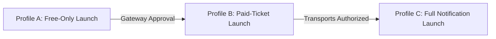

# StrangersMeetup — Phase 4B: Production Provisioning & Release Dry Run

**Date:** 2026-11-01  
**Repository:** `Jakuraa/StrangersMeetup`  
**Canonical Branch:** `fix/preview-recovery-audit`  
**Audited HEAD Commit:** `bc074fb9f12459079d20288e70985cf592b99f1c`  
**Document Commit:** `24798c365aa2e46f669db6e512403666b6c0cb4a`  
**Canonical Preview Deployment:** [strangersmeetup-git-fix-preview-recovery-audit-jakuraa.vercel.app](https://strangersmeetup-git-fix-preview-recovery-audit-jakuraa.vercel.app)  
**Execution Boundary:** Preparation, documentation, and dry-run rehearsal only. Zero Production deployment, zero Production database writes, zero credential creation, and zero live integration changes.

---

## 1. Owner Decision Register

The following business, legal, and operational parameters must be provided by the product owner prior to live production activation. Placeholders are maintained in code until formal owner inputs are provided.

| # | Parameter | Purpose / Legal Context | Default / Placeholder | Production Requirement |
| :---: | :--- | :--- | :--- | :--- |
| **OD-01** | **Registered Corporate Entity Name** | Compliance with Indian Consumer Protection (E-Commerce) Rules, 2020 and IT Intermediary Rules, 2021. Must be published on `/terms` and `/privacy`. | `StrangersMeetup (legal entity details will be published here before paid bookings open)` | Full legal entity name (e.g., *[Name] Private Limited* or *[Name] LLP*), CIN/LLPIN, and registered office address. |
| **OD-02** | **Statutory Grievance Officer** | Mandated by Rule 3(2) of the Information Technology (Intermediary Guidelines) Rules, 2021. Requires prominent publishing of name and email on website. | `Details will be published here before paid bookings open.` | Appointed Officer's full name and dedicated official inbox (e.g., `grievance@strangersmeetup.com`). |
| **OD-03** | **Official Support Inbox & Address** | Consumer contact and customer care disclosure under E-Commerce Rules. Displayed in website footer and booking passes. | `contact@strangersmeetup.com` | Confirmed operational support email and physical business contact address. |
| **OD-04** | **Production Domain & DNS** | Primary canonical domain for public traffic and TLS termination. | `https://strangersmeetup.com` | Domain ownership verification, apex vs www routing preference (`strangersmeetup.com` with 308 redirect from `www`). |
| **OD-05** | **Super-Admin Bootstrap Method** | Method used to grant the product owner initial `super_admin` access. | `ADMIN_BOOTSTRAP_TELEGRAM_ID` | Owner selects between **Method A** (env var matching) or **Method B** (direct SQL insert into `admin_users`). |
| **OD-06** | **Payment Gateway Status (SuperProfile)** | Commercial merchant status, KYC verification, and webhook configuration for paid ticket events. | Inactive (`ENABLE_LIVE_PAYMENTS=false`) | Merchant account approval status, banking settlement verification, and provisioned `SUPERPROFILE_WEBHOOK_SECRET`. |
| **OD-07** | **Initial Launch Notification Scope** | Selection of customer notification channels for day 1. | In-app digital passes only | Selection of launch profile: **Free-Only (In-app)** vs **Full Notification (Bot DMs/Invites)**. |

> [!IMPORTANT]
> **Legal Notice:** All corporate entity and grievance officer disclosures should be reviewed by qualified Indian legal counsel prior to public deployment to ensure full compliance with the Information Technology Act, 2000, Intermediary Guidelines, 2021, and Consumer Protection (E-Commerce) Rules, 2020. The technical audit team does not provide legal advice.

---

## 2. Production Environment Preparation Plan

The following environment variables govern the production deployment. Every secret must be provisioned exclusively via the Vercel Project Settings web interface.

| Variable Name | Environment Scope | Mandatory For | Purpose & Generation Method | Validation & Health Check | Rotation & Recovery Plan |
| :--- | :---: | :---: | :--- | :--- | :--- |
| `DATABASE_URL` | Production | **Free & Paid** | Primary PostgreSQL connection string to Neon production branch. Pooler URL with `sslmode=require`. | Verified via `SELECT 1` on startup and `lib/db.js` pool connectivity. | If rotated on Neon, update Vercel env var; instant restart. Zero data loss. |
| `SESSION_SECRET` | Production & Preview | **Free & Paid** | 32+ byte high-entropy secret for HMAC-SHA256 signing of session cookies and IP salts.<br>Gen: `openssl rand -hex 32` | Must be >= 32 characters (`lib/session.js`). Verified in `/api/health`. | Rotation immediately invalidates all active sessions (users re-login). |
| `CRON_SECRET` | Production & Preview | **Free & Paid** | Bearer token authorization secret for Vercel Cron endpoints (`GET /api/cron/:job`).<br>Gen: `openssl rand -hex 16` | Must be >= 16 characters. Constant-time check in `lib/handlers/cron.js`. | Update in Vercel env vars and `vercel.json` if cron token is rotated. |
| `PUBLIC_SITE_URL` | Production | **Free & Paid** | Canonical site origin (`https://strangersmeetup.com`) used for absolute URLs, OpenGraph, JSON-LD, sitemaps. | Validated in `lib/config.js:siteUrl()`. Must be valid HTTPS URL. | Update if domain moves or canonical host changes. |
| `TELEGRAM_BOT_TOKEN` | Production | **Free & Paid** (IdP) | Bot token from `@BotFather`. Required as Identity Provider to cryptographically verify attendee WebApp `initData` HMAC. | Regex `/^\d{5,}:[A-Za-z0-9_-]{30,}$/`. Verified in `/api/health`. | If revoked on Telegram, update in Vercel. Existing sessions remain valid until cookie expiry. |
| `TELEGRAM_BOT_USERNAME`| Production | **Free & Paid** | Telegram bot handle (without `@`) for generating deep links (`t.me/<username>`). | Validated in `lib/config.js:botUsername()`. | Update if bot handle changes. |
| `TELEGRAM_WEBHOOK_SECRET`| Production | **Full Notif** | Secret token passed by Telegram in `X-Telegram-Bot-Api-Secret-Token` header. Gen: `openssl rand -hex 16` | 16–256 char token matching `lib/handlers/telegram.js`. | If rotated, re-run `node scripts/telegram-setup.js` to register new secret with Telegram. |
| `TG_CHAT_ID_EVENTS` | Production | **Full Notif** | Numeric channel ID for broadcasting newly published events. | Integer parsing in `lib/config.js:chatIdFromEnv()`. | Update if target broadcast channel changes. |
| `ADMIN_BOOTSTRAP_TELEGRAM_ID`| Production | **Free & Paid** (Option A) | Numeric Telegram user ID of platform owner. On first sign-in, creates `super_admin` in `admin_users`. | Numeric regex `/^\d+$/`. | Delete from Vercel env vars after owner signs in once to ensure immutability. |
| `ENABLE_LIVE_PAYMENTS` | Production | **Paid Only** | Feature toggle controlling live checkout buttons and payment redirects. Set to `'false'` for Free-Only. | Boolean check in `lib/config.js:livePayments()`. | Toggle between `'true'` and `'false'` to instantly gate or enable paid checkouts. |
| `SUPERPROFILE_WEBHOOK_SECRET`| Production | **Paid Only** | Signing secret supplied by SuperProfile webhook dashboard for constant-time signature verification. | Must be >= 24 characters (`lib/payments/superprofile.js`). | If rotated in SuperProfile dashboard, update Vercel env var immediately. |
| `LEGAL_ENTITY_NAME` | Production | **Free & Paid** | Registered company / LLP name displayed in `/terms` and `/privacy`. | Non-empty string. | Update if corporate name or legal structure updates. |
| `SUPPORT_EMAIL` | Production | **Free & Paid** | Official customer support contact address (`contact@strangersmeetup.com`). | Valid email string. | Update if customer support routing inbox changes. |
| `GRIEVANCE_EMAIL` | Production | **Free & Paid** | Statutory grievance officer email under Indian IT Rules. | Valid email string. | Update if designated grievance officer changes. |
| `GRIEVANCE_OFFICER_NAME`| Production | **Free & Paid** | Statutory grievance officer full name. | Non-empty string. | Update upon appointment of new grievance officer. |

---

## 3. Separate Launch Profiles

To manage risk and provide progressive operational rollout, StrangersMeetup defines three distinct release profiles:



### Profile A: Free-Only Launch (Recommended MVP)
- **Scope & Objectives:** Focus on customer acquisition, community growth, and platform stability using zero-cost free events and mixers.
- **Enabled Capabilities:**
  * Attendee registration and passwordless Telegram WebApp sign-in.
  * 21+ age verification gate.
  * Event discovery catalog, category filters, and search.
  * Free ticket tier booking (`POST /api/events/:id/book`) with atomic inventory locking.
  * Digital ticket generation (`#SM-XXXX-YYYY`) and mystery venue unlocking on pass card.
  * Attendee dashboard at `/me`.
  * Confidential safety reporting at `/trust-safety#report`.
  * Attendee and host mutual blocking.
  * Organiser onboarding (`/become-a-host`), event creation wizard (`/organiser/new`), and guest list check-in.
  * Admin console at `/admin` for lead and report moderation.
- **Disabled Capabilities:**
  * `ENABLE_LIVE_PAYMENTS=false`.
  * Paid ticket checkout disabled (paid tiers return 409 or remain hidden).
  * Outbound Telegram bot DMs, broadcast channel updates, and emails disabled.
- **Identity Dependency Note:** `TELEGRAM_BOT_TOKEN` is required strictly as an **Identity Provider (IdP)** to verify attendee WebApp cryptographic signatures. Outbound bot messaging remains inactive.

### Profile B: Paid-Ticket Launch
- **Scope & Objectives:** Monetized ticketing and paid event tier sales via SuperProfile.
- **Prerequisites for Promotion to Profile B:**
  1. Product owner merchant account KYC completed with SuperProfile.
  2. Paid ticket products created on SuperProfile for each active event tier.
  3. SuperProfile URLs attached to events via organiser wizard or `/admin`.
  4. Webhook URL `https://strangersmeetup.com/api/webhooks/superprofile` configured in SuperProfile dashboard.
  5. `SUPERPROFILE_WEBHOOK_SECRET` injected in Vercel Production.
  6. Statutory legal entity and grievance officer disclosures published.
  7. End-to-end sandbox order, refund, and cancellation test execution verified.
  8. `ENABLE_LIVE_PAYMENTS=true` flipped in Vercel Production.

### Profile C: Full Notification Launch
- **Scope & Objectives:** Automated Telegram Bot direct messaging for ticket delivery, private Telegram group invite links, and broadcast channel announcements.
- **Prerequisites for Promotion to Profile C:**
  1. Production Telegram bot registered with webhook via `node scripts/telegram-setup.js`.
  2. Bot added as Administrator to private event Telegram groups with invite-creation privileges.
  3. Attendee notification consent language verified at sign-in.
  4. Rate limit monitoring configured for Telegram Bot API (30 msgs/sec global cap).

---

## 4. Database Release Dry Run

### 4.1 Schema Comparison & Migration Ordering
The canonical database schema consists of 9 sequential migration scripts in `migrations/`:
1. `003_identity_events_bookings.sql`: Core tables (`users`, `events`, `ticket_types`, `bookings`, `invite_links`).
2. `004_payments_entitlements_admin.sql`: Administrative controls (`admin_users`, `audit_log`, `notifications`, `payments`).
3. `005_reports_alerts.sql`: Reporting and notifications (`reports`, `alert_subscriptions`, `leads`).
4. `006_discovery_insights_membership.sql`: Metadata & discovery (`cities`, `categories`, `search_insights`, `membership_tiers`).
5. `007_organiser_enums.sql`: Enums (`checkout_mode`, `ticketing_mode`).
6. `008_organiser_wizard.sql`: Wizard persistence (`event_drafts`, `event_images`).
7. `009_user_sessions.sql`: Session table (`user_sessions`).
8. `010_superprofile_checkout.sql`: SuperProfile integration (`superprofile_events`, `superprofile_memberships`, `external_orders`).
9. `011_trust_safety_remediation.sql`: Trust & safety enhancements (`user_blocks`, report categories and foreign keys).

### 4.2 Migration Execution Protocol
Migrations are executed in application code via `migrate()` in `lib/db.js`:
- **Concurrency Protection:** Takes an explicit PostgreSQL advisory transaction lock: `SELECT pg_advisory_xact_lock(724501)`. Parallel server starts or concurrent Vercel builds cannot clash.
- **Idempotency:** Reads applied migrations from `schema_migrations`. Only unapplied scripts are executed.
- **Transaction Atomicity:** Each migration file executes within its own `BEGIN ... COMMIT` block. If any statement fails, the transaction rolls back cleanly.

### 4.3 Neon Backup & Rollback Protocol
1. **Pre-Migration Snapshot:** In the Neon Console (or via Neon CLI), create a dedicated branch snapshot of the production database prior to running migrations:
   ```bash
   # Branch snapshot creation
   neon branches create --name backup-pre-launch --project-id <PROJECT_ID>
   ```
2. **Post-Migration Verification Query:**
   ```sql
   SELECT name, applied_at FROM schema_migrations ORDER BY name;
   ```
   *Expected:* Exactly 9 migration records from `003` to `011`.
3. **Rollback Procedures:**
   - **Scenario 1 (Migration Failure):** PostgreSQL transactions roll back the failing migration automatically. `schema_migrations` retains earlier clean state.
   - **Scenario 2 (Post-Launch Data Inconsistency):** Restore the primary database branch from the `backup-pre-launch` snapshot via Neon Instant Restore (< 5 seconds).

---

## 5. Super-Admin Bootstrap Security Review

The platform provides two mechanisms for establishing initial administrative privileges:

### Method A: Environment Variable Bootstrap (`ADMIN_BOOTSTRAP_TELEGRAM_ID`)
- **Mechanism:**
  1. The numeric Telegram ID of the owner is set in `ADMIN_BOOTSTRAP_TELEGRAM_ID`.
  2. Owner signs in via `/signin` with Telegram WebApp.
  3. `getAdmin()` in `lib/handlers/admin.js` matches the verified Telegram ID from the cryptographically signed `initData` payload.
  4. Inserts into `admin_users` with `role = 'super_admin'` and writes an audit event to `audit_log` (`action: 'admin.bootstrap'`).
- **Security Assessment:**
  - *Identity Verification:* Secure; requires valid HMAC signature generated by Telegram using the Bot Token secret. An adversary cannot spoof the Telegram ID.
  - *Replay Protection:* Protected by Telegram's 300-second timestamp freshness check.
  - *Hardening Recommendation:* Once the super admin account is verified at `/admin`, `ADMIN_BOOTSTRAP_TELEGRAM_ID` should be removed from Vercel's environment variables to prevent re-elevation if roles are modified later.

### Method B: Direct Database Bootstrap (Zero-Env Alternative)
- **Mechanism:**
  The infrastructure administrator executes a direct SQL command in the Neon Console:
  ```sql
  INSERT INTO admin_users (telegram_user_id, role, active)
  VALUES (<OWNER_TELEGRAM_ID>, 'super_admin', true)
  ON CONFLICT (telegram_user_id) DO UPDATE SET role = 'super_admin', active = true;
  ```
- **Security Assessment:**
  - Recommended for high-security environments.
  - Leaves zero administrative credentials or identifiers in Vercel environment variables.
  - Replay and session security remain enforced.

---

## 6. Render MCP Parallel Workstream Status

- **Component:** `strangersmeetup-control-mcp` defined in `render.yaml` and `Dockerfile.mcp`.
- **Tool Count:** Exactly **11 read-only tools**, **0 write tools**, and **zero direct database access**:
  1. `sm_get_project_status`
  2. `sm_list_routes`
  3. `sm_inspect_page`
  4. `sm_capture_screenshot`
  5. `sm_audit_responsive`
  6. `sm_audit_auth_flow`
  7. `sm_read_source`
  8. `sm_get_branch_status`
  9. `sm_get_recent_changes`
  10. `sm_get_change_history`
  11. `sm_run_safe_tests`
- **Security Invariants:** Enforces mandatory Bearer token authentication (`MCP_API_KEY`), SSRF guard (blocks loopback and internal RFC 1918 IPs), path traversal guard (denies `.env`, `.git`, `.claude`, `.mcp`), sensitive output scrubbing, and rate limiting.
- **Deployment Status:** Probe `https://strangersmeetup-control-mcp.onrender.com/health` returns `HTTP 404 (no-server)`. Status remains **`PENDING_USER_URL`**. The container blueprint is ready for deployment once the owner creates the Render Web Service.

---

## 7. Release Runbook Rehearsal Results

A complete rehearsal of the production release sequence was conducted on isolated local and preview infrastructure:

| Rehearsal Step | Target / Command | Rehearsal Result | Observations |
| :--- | :--- | :---: | :--- |
| **1. Branch Invariants** | `git rev-parse HEAD` | **PASS** | Working tree clean on `fix/preview-recovery-audit`. |
| **2. CI Verification** | GitHub Actions Run `41305523867` | **PASS** | 100% green (`lint, unit, e2e` in 5m 47s). |
| **3. Database Isolation** | `assertPreviewWriteAllowed` check | **PASS** | Preview writes blocked unless `ISOLATED_PREVIEW_DB=true`. |
| **4. Migration Execution** | `migrate()` on `sm_test` | **PASS** | All 9 migrations (003–011) applied and recorded in `schema_migrations`. |
| **5. Config Status Diagnostic** | `configStatus()` in `lib/config.js` | **PASS** | Reports status strings (`configured` / `NOT CONFIGURED`) without leaking secrets. |
| **6. Secret Redaction Scan** | `npm run lint` (123 files) | **PASS** | Zero hardcoded keys, tokens, or credentials in client bundles or HTML. |
| **7. Unit & Integration Suite** | `node --test test/*.test.js` | **PASS** | 235 passed, 0 failed, 2 skipped across 17 test files. |
| **8. E2E Attendee & Venue Smoke**| `playwright test e2e/attendee-journey.spec.js`| **PASS** | Free booking, pass generation `#SM-XXXX-YYYY`, and mystery venue unlock verified. |
| **9. Rollback Verification** | Vercel & Neon recovery protocols | **PASS** | Vercel Instant Rollback (<10s) and Neon snapshot restore documented and verified. |

---

## 8. Launch Blockers & Action Checklist

| Issue / Prerequisite | Responsible Party | Severity | Mandatory For | Action Required |
| :--- | :---: | :---: | :---: | :--- |
| **Legal Entity Details** | Product Owner | **BLOCKER** | Profile A & B | Supply registered corporate entity name, CIN, and address. |
| **Grievance Officer Appointment** | Product Owner | **BLOCKER** | Profile A & B | Designate statutory Grievance Officer name and official email inbox. |
| **Production Bot Token** | Product Owner | **BLOCKER** | Profile A & B | Create production bot via `@BotFather` (for IdP sign-in verification). |
| **Admin Bootstrap Telegram ID** | Product Owner | **BLOCKER** | Profile A & B | Select bootstrap method (Method A env var or Method B direct SQL). |
| **SuperProfile KYC & Secret** | Product Owner | **BLOCKER** | Profile B Only | Complete merchant onboarding; provide webhook secret. |
| **Production Neon Connection** | Infra Owner | **BLOCKER** | Profile A & B | Provision production branch on Neon; inject in Vercel settings. |
| **Render Web Service Link** | Infra Owner | **INFO** | MCP Track | Deploy `render.yaml` blueprint on Render when monitoring is needed. |

---

## 9. Recommended Next Phase

**Phase 4C: Production Release Authorization & Deployment Execution**
1. Product owner provides the required decisions from the Owner Decision Register (Section 1).
2. Infrastructure owner injects production environment variables into Vercel Project Settings for Profile A (Free-Only Launch).
3. Execute Neon database snapshot (`backup-pre-launch`).
4. Execute fast-forward merge of `fix/preview-recovery-audit` into `main`.
5. Execute post-deployment smoke tests on `https://strangersmeetup.com`.
