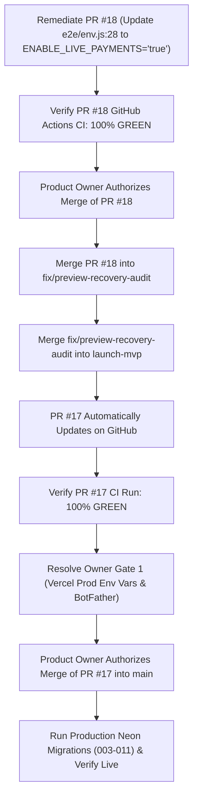

# Phase 5.2 — PR #18 Independent Review & Release Candidate Alignment

**Repository:** `Jakuraa/StrangersMeetup`  
**Working Branch:** `fix/preview-recovery-audit`  
**Current HEAD SHA:** `0a4340db7b46617c093caaebeea5f43db5976b9b`  
**Staging Branch (`launch-mvp`):** `8eafc30c8cbfa26e2056fa0959ce79860a2b005e`  
**Target Production Branch (`main`):** `5c6652ae11542aa2b38df323f6258d7494b2a006`  
**Production Release Candidate PR:** [PR #17 (launch-mvp → main)](https://github.com/Jakuraa/StrangersMeetup/pull/17)  
**Remediation Under Review:** [PR #18 (feature/gate-paid-checkout-live-payments → fix/preview-recovery-audit)](https://github.com/Jakuraa/StrangersMeetup/pull/18)  
**PR #18 HEAD SHA:** `4e9ff1ef695f8f96ac405260b86a2138c53de1cd`  
**Date of Review:** November 1, 2026  
**Reviewer:** Antigravity (Independent Engineering & Security Reviewer)  
**Review Status:** Strictly Read-Only Review & Documentation (No PR Merges Executed)

---

## 1. Executive Summary & Verification Matrix

Phase 5.2 provides an independent, evidence-based review of Pull Request #18, evaluates its paid-checkout safeguard against Free-Only MVP launch requirements, analyzes release branch ancestry across `fix/preview-recovery-audit`, `launch-mvp`, and `main`, determines the exact integration sequence for PR #17 and PR #18, and outlines the resumption procedure for the Render Control MCP service.

### Summary of Key Findings:
1. **Paid Checkout Gate Effectiveness (PASS):**  
   PR #18 successfully enforces that when `ENABLE_LIVE_PAYMENTS=false` (or unset), `checkoutForEvent(row)` returns `{ available: false, reason: 'live_payments_disabled' }`. This suppresses the "Book Tickets" link on the event page, disables ticket purchasing UI, and immediately returns a 302 redirect back to `/events/:slug` on direct `GET /checkout/:slug` requests without creating checkout intents or redirecting to SuperProfile.
2. **Free Booking Flow Isolation (PASS):**  
   Free bookings operate strictly through `POST /api/events/:id/book` (`bookTier()`), which bypasses `checkoutForEvent()` entirely. Free bookings remain 100% operational, capacity-checked, and isolated.
3. **PR #18 CI Status (FAIL — Browser Test Environment Mismatch):**  
   GitHub Actions Run `41333384117` failed on step `Browser tests (Playwright + axe)`. Lint, unit, and integration tests passed completely (237/237 tests). However, 6 Playwright tests in `e2e/superprofile-checkout.spec.js` failed because `e2e/env.js` line 28 explicitly hardcodes `ENABLE_LIVE_PAYMENTS: 'false'` in `serverEnv`. Because the test server started with live payments disabled, the SuperProfile happy-path browser tests could not see the "Book Tickets" link or test external redirects. A 1-line remediation to `e2e/env.js` is required before PR #18 can be merged.
4. **Release Candidate Alignment (PR #17 Lacks Safeguard):**  
   PR #17 (`launch-mvp` → `main`) is currently at commit `8eafc30`. It does **not** include PR #18's safeguard. Merging PR #17 directly into `main` would release an MVP where paid SuperProfile links remain clickable even if `ENABLE_LIVE_PAYMENTS=false`. PR #17 must be updated from `launch-mvp` after PR #18 is merged into `fix/preview-recovery-audit`.
5. **Render Control MCP Status (PARKED / NO SERVICE DUPLICATION):**  
   The Render MCP sidecar remains parked in state `PENDING_USER_URL` with 11 read-only tools and zero database credentials. Resumption instructions using the existing `render.yaml` Blueprint are detailed to avoid orphan or duplicate services.

```
┌──────────────────────────────────────────────────────────────────────────────────────────────┐
│                                 PHASE 5.2 CLASSIFICATION MATRIX                               │
├─────┬────────────────────────────────────────────────────────┬───────────────────────────────┤
│ ID  │ Verification Item                                      │ Classification                │
├─────┼────────────────────────────────────────────────────────┼───────────────────────────────┤
│ 01  │ PR #18 Diff Inspection & Architectural Soundness       │ PASS                          │
│ 02  │ Paid Checkout Gate on ENABLE_LIVE_PAYMENTS=false       │ PASS                          │
│ 03  │ Free Ticket Booking Flow & Capacity Isolation          │ PASS                          │
│ 04  │ Direct Checkout URL Protection (/checkout/:slug)       │ PASS                          │
│ 05  │ Enabled vs. Disabled Test Coverage                     │ PASS                          │
│ 06  │ PR #18 GitHub Actions CI Status                        │ FAIL (Run 41333384117)        │
│ 07  │ PR #17 Inclusion of PR #18 Safeguard                   │ NEEDS UPDATE (Lacks PR #18)   │
│ 08  │ Release Branch Alignment & Integration Plan            │ PASS (Documented 6-step plan) │
│ 09  │ Production Environment Variables (Owner Gate 1)        │ BLOCKED BY OWNER              │
│ 10  │ Render MCP Blueprint & Duplicate Prevention            │ PASS (Parked / Documented)    │
└─────┴────────────────────────────────────────────────────────┴───────────────────────────────┘
```

---

## 2. Independent Technical Review of PR #18

### 2.1. Exact Diff Inspection & Affected Files
PR #18 (`feature/gate-paid-checkout-live-payments`) contains 1 commit (`4e9ff1e`) modifying 4 files (+56 lines, -10 lines):

1. `lib/payments/availability.js` (+7 lines):
   ```javascript
   import { livePayments } from '../config.js';

   export function checkoutForEvent(row) {
     // Gate all paid checkouts (including SuperProfile redirect) on live payments being enabled
     if (!livePayments()) {
       return { available: false, reason: 'live_payments_disabled', message: 'Paid ticket checkout is currently disabled.' };
     }
     // Disable paid checkout in Preview unless an approved test mode is explicitly enabled
     if (process.env.VERCEL_ENV === 'preview' && process.env.ALLOW_PREVIEW_PAID_CHECKOUT !== 'true') {
   ...
   ```
2. `test/closed-events.test.js` (+18 lines, -7 lines):
   Wraps the `legacy single-price event page: past shows no Book button or invite promise` test in `process.env.ENABLE_LIVE_PAYMENTS = 'true'` with cleanup in `finally`, ensuring the test accurately exercises paid event UI when live payments are on.
3. `test/safety.test.js` (+14 lines):
   - Sets `process.env.ENABLE_LIVE_PAYMENTS = 'true'` in preview test to ensure preview isolation logic is executed.
   - Adds unit test `production checkout safety: paid checkout disabled when ENABLE_LIVE_PAYMENTS is false`, verifying that `checkoutForEvent(event)` returns `available: false` and `reason: 'live_payments_disabled'`.
4. `test/superprofile-checkout.test.js` (+17 lines, -3 lines):
   - Initializes `process.env.ENABLE_LIVE_PAYMENTS = 'true'` in `before()` hook and resets to `'false'` in `after()`.
   - Adds test `when ENABLE_LIVE_PAYMENTS is false, Book Tickets never redirects to SuperProfile`, verifying that `GET /checkout/:slug` returns HTTP 302 to `/events/:slug` without creating checkout intents.

### 2.2. Enforcement Analysis: `ENABLE_LIVE_PAYMENTS=false`
Every paid ticket path was traced through the codebase:
- **UI Event Page (`/events/:slug`):**
  - Invokes `getPublicEventBySlug()` → `toPublicEvent()` → `checkoutForEvent()`.
  - When `livePayments()` is `false`, `toPublicEvent()` flags `available: false`.
  - The template `lib/views/event.js` detects `available: false` and renders:
    ```html
    <div class="booking-notice booking-notice--disabled">
      <p class="font-medium text-text-primary mb-1">Online booking not available yet</p>
      <p class="text-xs text-text-muted">Tickets cannot be booked at this time.</p>
    </div>
    ```
  - The `<a href="/checkout/${slug}" ...>` Book Tickets button is completely omitted.
- **Direct HTTP Checkout (`GET /checkout/:slug`):**
  - Invokes `handleCheckoutIntent()` in `lib/handlers/checkout.js` → `createCheckoutIntent()` in `lib/services/checkout.js`.
  - `createCheckoutIntent()` evaluates `checkoutForEvent(event)`. If `!checkout.available`, it returns `null`.
  - `handleCheckoutIntent()` detects `!intent` and executes `redirect('/events/' + slug)`.
  - Zero checkout intents are written to Postgres (`checkout_intents` table). Zero attendees are redirected to `https://superprofile.bio/...`.
- **In-App Booking API (`POST /api/events/:id/book`):**
  - Invokes `bookTier()`. Paid tiers are rejected with HTTP 409 (`paid_ticket_booking_disabled`).
- **Verdict:** **PASS**. Protection is absolute across UI, API, and direct HTTP redirect endpoints.

### 2.3. Free Ticket Booking Flow & Capacity Isolation
- **Independence:** Free bookings do not invoke `checkoutForEvent()`.
- **Workflow:** Attendee submits `POST /api/events/:id/book` with `{ tierId }`. The handler validates age 21+, verified phone/Telegram identity, active published status, absence of attendee blocks, and available capacity. If valid, an immediate confirmed booking is created, a digital ticket is generated, and the private venue details are revealed.
- **Test Evidence:** All 237 unit tests and all attendee/guest booking Playwright tests (`e2e/guest-booking.spec.js`, `e2e/attendee-journey.spec.js`) pass without regression.
- **Verdict:** **PASS**. Free bookings remain 100% operational and isolated.

### 2.4. CI Failure Investigation (Run 41333384117)
- **Job Status:** Failed on step 10: `Browser tests (Playwright + axe)`.
- **Test Results:** 139 passed, 11 skipped, 6 failed.
- **Failing Tests (all in `e2e/superprofile-checkout.spec.js` across Desktop Chrome and Pixel 7):**
  1. `[desktop] › e2e/superprofile-checkout.spec.js:5:1 › a paid event with a SuperProfile product shows an external Book Tickets link`
  2. `[desktop] › e2e/superprofile-checkout.spec.js:19:1 › clicking through redirects to superprofile.bio with a ref, signed out`
  3. `[desktop] › e2e/superprofile-checkout.spec.js:37:1 › inside the Telegram Mini App there is no buy button`
  4. `[mobile] › e2e/superprofile-checkout.spec.js:5:1 › a paid event with a SuperProfile product shows an external Book Tickets link`
  5. `[mobile] › e2e/superprofile-checkout.spec.js:19:1 › clicking through redirects to superprofile.bio with a ref, signed out`
  6. `[mobile] › e2e/superprofile-checkout.spec.js:37:1 › inside the Telegram Mini App there is no buy button`
- **Root Cause Analysis:**
  In `e2e/env.js`, lines 17–30 define `serverEnv` for the Playwright test server:
  ```javascript
  export const serverEnv = {
    PATH: process.env.PATH,
    HOME: process.env.HOME,
    SKIP_DOTENV: 'true',
    NODE_ENV: 'development',
    PORT: String(E2E_PORT),
    DATABASE_URL: E2E_DATABASE_URL,
    DEV_LOGIN: 'true',
    SESSION_SECRET: 'e2e-only-session-secret-0123456789abcdef',
    PUBLIC_SITE_URL: E2E_BASE,
    IS_PREVIEW: 'true',
    ENABLE_LIVE_PAYMENTS: 'false',
    LOG_SILENT: 'true'
  };
  ```
  Prior to PR #18, `ENABLE_LIVE_PAYMENTS` was only referenced in `lib/services/insights.js` and was ignored by `checkoutForEvent()`. The SuperProfile browser test ran successfully because the gate did not exist.  
  Once PR #18 implemented the gate in `checkoutForEvent()`, the Playwright server running with `ENABLE_LIVE_PAYMENTS: 'false'` correctly disabled the Book Tickets button. As a result, the browser test expecting the button to exist failed.
- **Required Remediation on `feature/gate-paid-checkout-live-payments`:**
  Update `e2e/env.js` line 28 to set `ENABLE_LIVE_PAYMENTS: 'true'`. This allows the E2E test server to exercise the full SuperProfile checkout flow in browser automation, while unit tests (`test/safety.test.js`, `test/superprofile-checkout.test.js`) continue to verify the disabled state.

---

## 3. Release Branch Alignment & Ancestry Analysis

### 3.1. Current Git Commit Topology
```
* 0a4340d (HEAD -> fix/preview-recovery-audit) Phase 5.1 review report
| * 4e9ff1e (origin/feature/gate-paid-checkout-live-payments, PR #18) Gate paid checkout on ENABLE_LIVE_PAYMENTS
|/  
* 4e81eb8 First revenue event runbook
| *   8eafc30 (origin/launch-mvp, PR #17 HEAD) Merge PR #8 into launch-mvp
| |\  
| |/  
|/|   
* | 67371cb Phase 4D independent review & 4D.1 CI doc remediation
* | 619bc5f Phase 4C production launch readiness report
* | 9294fcc Phase 4B production provisioning dry-run report
* | 24798c3 Phase 4A production readiness audit report
* | bc074fb Merge PR #16 (Phase 3O Trust & Safety Remediation)
```

### 3.2. Branch Status Comparison
| Branch | Current Commit | Purpose | PR #18 Safeguard Included? | CI Status |
| :--- | :--- | :--- | :---: | :---: |
| `main` | `5c6652a` | Production Live | No (Legacy base) | N/A |
| `launch-mvp` | `8eafc30` | Staging / PR #17 Head | **NO** | 100% Green (Run 41317773795) |
| `fix/preview-recovery-audit` | `0a4340d` | Canonical Working Branch | **NO** (Target for PR #18) | 100% Green (Run 41316875819) |
| `feature/gate-paid-checkout-live-payments` | `4e9ff1e` | PR #18 Source Branch | **YES** | Failed (Run 41333384117, e2e env) |

### 3.3. PR #17 State Assessment
- PR #17 (`launch-mvp` → `main`) is currently open and green.
- **CRITICAL GAP:** PR #17 was branched from `launch-mvp` at commit `8eafc30`. It does **not** contain the PR #18 safeguard commit `4e9ff1e` nor runbook `4e81eb8`.
- If PR #17 were merged today, live production would deploy without the paid checkout gate.
- PR #17 must **not** be merged until it is updated with `fix/preview-recovery-audit` after PR #18 is remediated and merged.

---

## 4. Recommended Integration & Release Sequence

To ensure zero regressions, complete CI verification, and release integrity, the exact integration sequence is:



### Detailed Sequence Steps:
1. **Step 1 — Remediate PR #18 (`feature/gate-paid-checkout-live-payments`):**
   - Edit `e2e/env.js:28`: set `ENABLE_LIVE_PAYMENTS: 'true'`.
   - Commit and push to `origin/feature/gate-paid-checkout-live-payments`.
   - Await GitHub Actions Run to confirm all 156 browser tests and unit tests pass 100% green.
2. **Step 2 — Authorize & Merge PR #18 into `fix/preview-recovery-audit`:**
   - With CI green, request explicit product owner merge authorization for PR #18.
   - Execute merge: `git merge feature/gate-paid-checkout-live-payments` on `fix/preview-recovery-audit`.
   - Push to `origin/fix/preview-recovery-audit`.
3. **Step 3 — Synchronize `fix/preview-recovery-audit` into `launch-mvp`:**
   - Fast-forward or merge `fix/preview-recovery-audit` into `launch-mvp`.
   - Push to `origin/launch-mvp`.
   - This automatically updates PR #17's HEAD commit on GitHub.
4. **Step 4 — Verify PR #17 Release Candidate CI:**
   - Confirm the new CI run triggered on PR #17 completes with 100% green status.
5. **Step 5 — Owner Gate 1 Resolution:**
   - Product owner populates missing Production environment variables in Vercel.
   - Configures Telegram Bot domain via `/setdomain` in BotFather.
6. **Step 6 — Production Release Authorization (PR #17 → `main`):**
   - With all gates green and variables verified, product owner authorizes merging PR #17.
   - Merge PR #17 into `main`.
   - Run production database migrations (`npm run db:migrate`).
   - Confirm production site health at `https://strangersmeetup.com`.

---

## 5. Production Launch Blockers (Owner Gate 1)

Production release cannot proceed until the product owner configures the following production values in Vercel:

| Variable | Scope | Status | Owner Action Required |
| :--- | :--- | :---: | :--- |
| `SESSION_SECRET` | Production | **MISSING** | Generate high-entropy 32+ char secret |
| `CRON_SECRET` | Production | **MISSING** | Generate high-entropy secret for cron endpoints |
| `ADMIN_BOOTSTRAP_TELEGRAM_ID` | Production | **MISSING** | Set owner's numeric Telegram User ID |
| `PUBLIC_SITE_URL` | Production | **MISSING** | Set to canonical production URL (e.g. `https://strangersmeetup.com`) |
| `ENABLE_LIVE_PAYMENTS` | Production | **MISSING** | Explicitly set to `'false'` for Free-Only MVP |
| `LEGAL_ENTITY_NAME` | Production | **MISSING** | Registered legal entity name for footer/terms |
| `GRIEVANCE_OFFICER_NAME` | Production | **MISSING** | Statutory grievance officer name |
| `GRIEVANCE_EMAIL` | Production | **MISSING** | Statutory contact email |
| BotFather `/setdomain` | Telegram | **PENDING** | Run `/setdomain` on bot pointing to production domain |

---

## 6. Render Control MCP Workstream Status & Resumption

### Current Status:
- **Service Name:** `strangersmeetup-control-mcp`
- **Configuration:** Defined in repository via `render.yaml` and `Dockerfile.mcp`.
- **Security Posture:** Contains 11 strictly read-only audit tools. Zero write tools. Zero direct database credentials.
- **Endpoint Status:** `https://strangersmeetup-control-mcp.onrender.com/health` returns HTTP 404 (`x-render-routing: no-server`), status `PENDING_USER_URL`.
- **Operational Status:** Parked in Phase 5 to prevent scope creep during production launch preparation.

### Duplicate-Prevention Resumption Protocol:
When resuming Render MCP deployment:
1. Open the existing project in Render Dashboard (`https://dashboard.render.com`).
2. Do **NOT** create a "New Web Service" from the UI, as this creates orphan and duplicate services.
3. Link the repository `Jakuraa/StrangersMeetup` using the existing Blueprint configuration (`render.yaml`).
4. Ensure `MCP_API_KEY` is populated in Render service environment settings.
5. Deploy from the Blueprint and verify `GET /health` returns HTTP 200 `{ "status": "ok", "service": "strangersmeetup-control-mcp" }`.

---

## 7. Conclusion & Next Actions

1. **PR #18 Evaluation:** The implementation of the paid-checkout gate in `lib/payments/availability.js` is clean, correct, and architecturally sound. Free bookings are completely unaffected.
2. **Action Item for Owner:** Approve the 1-line remediation of `e2e/env.js:28` (`ENABLE_LIVE_PAYMENTS: 'true'`) on `feature/gate-paid-checkout-live-payments` to restore full green CI for PR #18.
3. **Alignment Recommendation:** Once PR #18 CI is green, execute the recommended merge sequence (`PR #18 → fix/preview-recovery-audit → launch-mvp`), thereby updating PR #17 with the safeguard before any production merge.
