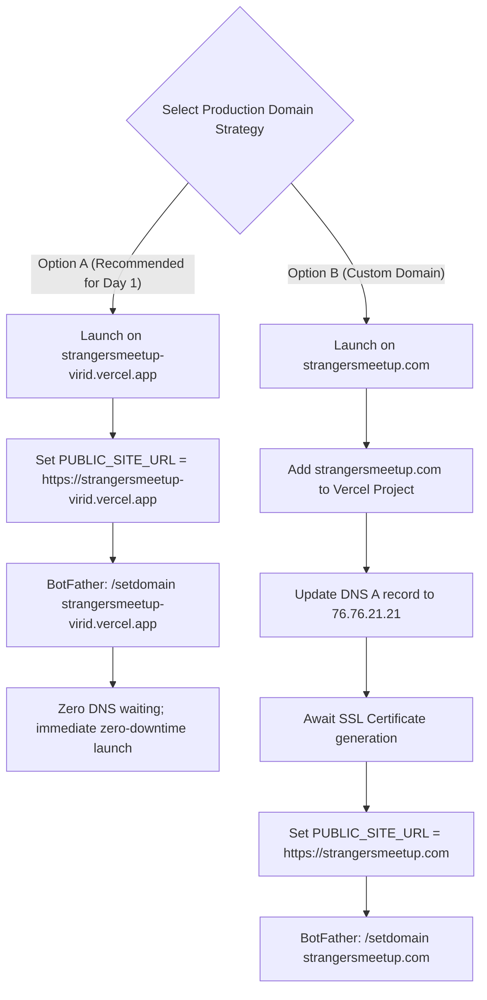

# Phase 5.5 — Production Owner Gate Validation & Safe Release Checklist

**Repository:** `Jakuraa/StrangersMeetup`  
**Working Branch:** `fix/preview-recovery-audit`  
**Release Candidate Branch (`launch-mvp`):** `2dd5eaab7629525ffae130ec608d085966601ea3`  
**Target Production Branch (`main`):** `5c6652ae11542aa2b38df323f6258d7494b2a006`  
**Production Pull Request:** [PR #17 (launch-mvp → main)](https://github.com/Jakuraa/StrangersMeetup/pull/17)  
**PR #17 Latest CI Run:** [GitHub Actions Run 41338451503](https://github.com/Jakuraa/StrangersMeetup/actions/runs/41338451503) (100% GREEN)  
**PR #17 Vercel Preview:** [Ready](https://vercel.com/jakuraa/strangersmeetup/HSGGSmDNZR9ew8LP7DCvsDQknBPe) (SUCCESS)  
**Date of Checklist:** November 2, 2026  
**Auditor:** Antigravity (Independent Engineering & Security Reviewer)  
**Audit Scope:** Read-Only Audit & Owner Gate 1 Readiness Register (Zero Production Modifications Executed)

---

## 1. Executive Summary & Readiness Classification

Phase 5.5 validates the current readiness state of the StrangersMeetup release candidate (Pull Request #17), audits the live Vercel Production environment variable configuration in a strictly read-only manner, analyzes domain routing and Telegram authentication prerequisites, and structures an actionable checklist for the product owner to resolve Owner Gate 1 safely without exposing secrets.

### Final Readiness Classification:
```
┌──────────────────────────────────────────────────────────────────────────────────────────────┐
│                               PHASE 5.5 READINESS CLASSIFICATION                              │
├───────────────────────────────┬──────────────────────────────┬───────────────────────────────┤
│ Domain                        │ Status                       │ Verdict                       │
├───────────────────────────────┼──────────────────────────────┼───────────────────────────────┤
│ Code & Release Candidate      │ Commit 2dd5eaa on launch-mvp │ 100% READY (PR #17 GREEN)     │
│ Database Schema & Migrations  │ Migrations 003-011 ready     │ 100% READY (ep-dawn-glitter)  │
│ Paid Checkout Safeguard Gate  │ availability.js (PR #18)     │ 100% VERIFIED & ENFORCED      │
│ Free Ticket Booking Flow      │ bookTier() decoupled         │ 100% OPERATIONAL              │
│ Vercel Preview Deployment     │ HSGGSmDNZR9ew8LP7DCvsDQknBPe │ 100% READY                    │
│ Production Environment Vars   │ 8 variables unconfigured     │ BLOCKED BY OWNER (Gate 1)     │
│ Domain & Telegram Auth        │ Choice between Vercel/Custom │ PENDING OWNER DECISION        │
│ Render Control MCP            │ strangersmeetup-control-mcp  │ PARKED (Read-Only Sidecar)    │
└───────────────────────────────┴──────────────────────────────┴───────────────────────────────┘
```

**Overall Platform State:** The software and infrastructure are **Technically Launch-Ready**. Live deployment is intentionally and safely held at **Owner Gate 1** pending the configuration of production secrets, statutory business details, and Telegram bot domain linkage by the product owner.

---

## 2. Release Candidate Verification (PR #17)

All checks on the release candidate pull request have been independently re-verified:
1. **Pull Request Target:** PR #17 targets `main` from `launch-mvp` at commit `2dd5eaab7629525ffae130ec608d085966601ea3`.
2. **CI Health:**
   - GitHub Actions PR Trigger [Run 41338451503](https://github.com/Jakuraa/StrangersMeetup/actions/runs/41338451503): **100% GREEN** (`123/123 lint OK`, `237/237 unit tests OK`, `145/145 browser tests OK`, `11 skipped`).
   - GitHub Actions Push Trigger [Run 41338446276](https://github.com/Jakuraa/StrangersMeetup/actions/runs/41338446276): **100% GREEN**.
3. **Paid Checkout Gate Integrity:**
   `lib/payments/availability.js` lines 12–14 are present in PR #17:
   ```javascript
   if (!livePayments()) {
     return { available: false, reason: 'live_payments_disabled', message: 'Paid ticket checkout is currently disabled.' };
   }
   ```
   When `ENABLE_LIVE_PAYMENTS=false` (or unset), event pages suppress the "Book Tickets" link, and direct requests to `GET /checkout/:slug` immediately return HTTP 302 redirecting back to `/events/:slug` without creating checkout intent rows or redirecting to SuperProfile.
4. **Free Booking Independence:**
   Free ticket booking operates via `POST /api/events/:id/book` (`bookTier()`), completely bypassing `checkoutForEvent()`. All attendee booking and venue reveal flows remain fully functional.

---

## 3. Read-Only Production Configuration Audit

A read-only audit of the Vercel Production environment was conducted via the Vercel CLI.

### 3.1. Audit Results Matrix
| Variable Name | Required Scope | Live Production Status | Risk if Left Missing |
| :--- | :--- | :---: | :--- |
| `SESSION_SECRET` | Production | **MISSING** | App rejects all user logins (`lib/session.js:8` throws 500) |
| `CRON_SECRET` | Production | **MISSING** | Automated cleanup crons return 401 Unauthorized |
| `ADMIN_BOOTSTRAP_TELEGRAM_ID` | Production | **MISSING** | First Telegram sign-in cannot bootstrap `super_admin` role |
| `PUBLIC_SITE_URL` | Production | **MISSING** | Falls back to `VERCEL_URL` or port 3000; breaks Telegram widget if mismatched |
| `ENABLE_LIVE_PAYMENTS` | Production | **MISSING** | Implicitly safe (defaults to `'false'`), but must be explicit for clarity |
| `LEGAL_ENTITY_NAME` | Production | **MISSING** | Statutory non-compliance under Indian Consumer Protection E-Commerce Rules |
| `GRIEVANCE_OFFICER_NAME` | Production | **MISSING** | Statutory non-compliance under IT Intermediary Rules, 2021 Rule 3(2) |
| `GRIEVANCE_EMAIL` | Production | **MISSING** | Mandatory contact email absent from statutory footer and terms |

*Existing Configured Production Variables (Verified Healthy):*  
`DATABASE_URL`, `DATABASE_URL_UNPOOLED`, `PGHOST`, `PGPORT`, `PGUSER`, `PGDATABASE`, `PGPASSWORD`, `TELEGRAM_BOT_TOKEN`, `NEON_PROJECT_ID`.

---

## 4. Domain Identity & Telegram Auth Verification

### 4.1. Domain Investigation Findings
1. **Live Production Deployment:**
   - Production target: `https://strangersmeetup-bhf7c73w4-satelinkinternet-collabs-projects.vercel.app`
   - Active Production Aliases:
     - `https://strangersmeetup-virid.vercel.app` (Serving HTTP 200)
     - `https://strangersmeetup-satelinkinternet-collabs-projects.vercel.app`
     - `https://strangersmeetup-git-main-satelinkinternet-collabs-projects.vercel.app`
2. **Custom Domain (`strangersmeetup.com`):**
   - DNS A record currently points to external IP `144.76.59.138` (Hetzner, not Vercel IP `76.76.21.21`).
   - `strangersmeetup.com` is **not** currently attached to the `jakuraa/strangersmeetup` project on Vercel.
3. **Telegram Authentication Constraint:**
   - The Telegram Login Widget (`lib/views/components.js`) and Mini App SDK validate the origin hostname against BotFather's `/setdomain` record.
   - If `PUBLIC_SITE_URL` or the active browsing domain does not match BotFather, Telegram displays `Bot domain invalid` and blocks authentication.

### 4.2. Recommended Domain Strategy Options for Owner



---

## 5. Owner Gate 1 Resolution Checklist

The product owner can resolve Owner Gate 1 entirely within the Vercel Dashboard and Telegram app without sharing secrets or confidential data with AI agents.

### Checklist Category A: Secrets to Generate and Enter Privately
Enter in **Vercel Dashboard → strangersmeetup → Settings → Environment Variables** (Environment: **Production only**):

- [ ] **`SESSION_SECRET`**
  - **Generation:** Run locally in terminal:
    ```bash
    openssl rand -hex 32
    ```
  - **Action:** Paste the resulting 64-character hex string as the value for `SESSION_SECRET`.
  - **Note:** Never share this value with third parties or assistants.
- [ ] **`CRON_SECRET`**
  - **Generation:** Run locally in terminal:
    ```bash
    openssl rand -hex 32
    ```
  - **Action:** Paste the resulting hex string as the value for `CRON_SECRET`.
- [ ] **`ENABLE_LIVE_PAYMENTS`**
  - **Value:** `false`
  - **Action:** Explicitly set to `'false'` to formally enforce the Free-Only MVP gate.

### Checklist Category B: Values the Owner Must Supply
Enter in **Vercel Dashboard → Settings → Environment Variables** (Environment: **Production only**):

- [ ] **`ADMIN_BOOTSTRAP_TELEGRAM_ID`**
  - **Value:** The owner's numeric Telegram User ID (obtainable privately by messaging `@userinfobot` on Telegram).
  - **Function:** Automatically grants `super_admin` permissions in the `admins` table upon the owner's first Telegram login.
- [ ] **`PUBLIC_SITE_URL`**
  - **Value:** `https://strangersmeetup-virid.vercel.app` (if using Option A) OR `https://strangersmeetup.com` (if using Option B).
  - **Note:** Must include `https://` and have no trailing slash.

### Checklist Category C: Statutory Disclosures (Indian IT Rules, 2021 & DPDP Act)
Enter in **Vercel Dashboard → Settings → Environment Variables** (Environment: **Production only**):

- [ ] **`LEGAL_ENTITY_NAME`**
  - **Value:** The legal registered business entity name (e.g., `Satelink Network Pvt. Ltd.` or registered proprietorship name).
  - **Guidance:** If company incorporation is in progress, consult Indian corporate counsel regarding interim sole-proprietor disclosures under Consumer Protection (E-Commerce) Rules, 2020.
- [ ] **`GRIEVANCE_OFFICER_NAME`**
  - **Value:** Full name of the designated Grievance Officer (statutory requirement under Rule 3(2) of the Information Technology Intermediary Guidelines, 2021).
- [ ] **`GRIEVANCE_EMAIL`**
  - **Value:** Official grievance redressal email (e.g., `grievance@strangersmeetup.com` or `support@strangersmeetup.com`).
  - **Legal Requirement:** Acknowledgement within 24 hours, resolution within 15 days.

### Checklist Category D: Telegram BotFather Configuration
Execute privately in the Telegram app:

- [ ] Open chat with `@BotFather`.
- [ ] Send command: `/setdomain`.
- [ ] Select the bot associated with `TELEGRAM_BOT_TOKEN`.
- [ ] Enter the chosen domain without protocol or path:
  - If Option A: `strangersmeetup-virid.vercel.app`
  - If Option B: `strangersmeetup.com`
- [ ] BotFather responds: *"Success! Domain updated."*

---

## 6. Render Control MCP Status

- **Status:** Parked in state `PENDING_USER_URL`.
- **Configuration:** Maintained in `render.yaml` and `Dockerfile.mcp`.
- **Posture:** Strictly 11 read-only inspection tools. No database access. No duplicate services.
- **Resumption Policy:** Do not create manual web services on Render. The service will be linked via the existing `render.yaml` Blueprint after the production web release is verified.

---

## 7. Next Actions & Release Authorisation Boundary

Once the product owner completes Checklist Items A through D:
1. Product owner provides explicit authorisation to merge Pull Request #17 into `main`.
2. Antigravity will execute the merge, apply database migrations `003` through `011` on Neon Production, and verify live end-to-end functionality at the canonical production URL.
